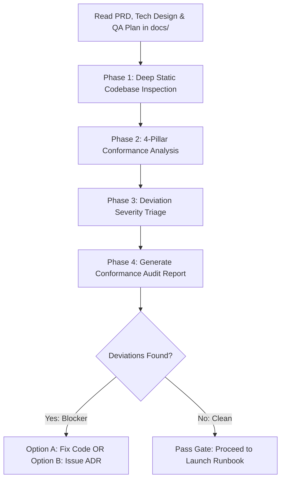

# Engineering Drift Auditor Skill

This skill acts as the quality and architectural gatekeeper during software development. It detects and diagnoses **Specification Drift** by comparing the actual source code, database migrations, and tests against your design documents.

It provides an authoritative **Conformance Audit Report** that categorizes deviations and gives two clear paths forward: **Fix the Code** or **Reconcile the Spec via an Architecture Decision Record (ADR)**.

---

## Workflow Overview



---

## Execution Phases

### Phase 0: Context & Spec Ingestion
1. Automatically scan the workspace for:
   - PRD: `docs/prd/<feature>-prd.md`
   - Tech Design / RFC: `docs/architecture/<feature>-tech-design.md`
   - QA Strategy: `docs/qa/<feature>-test-plan.md`
2. Extract the contract baselines:
   - Must-have user stories and acceptance criteria.
   - Declared API endpoints, request/response schemas, and headers.
   - Database tables, foreign keys, indexes, and migration strategy.
   - Security constraints (RBAC, encryption, rate limits).
   - Test pyramid requirements and specific edge cases.

---

### Phase 1: Deep Static Codebase Inspection
Inspect the codebase files across the project:
1. **API & Routing Layer:** Inspect controllers, route definitions, and schema validators (e.g. Zod, Joi, Pydantic, OpenAPI routers).
2. **Database & Persistence Layer:** Inspect migration files (`migrations/`, `prisma/schema.prisma`, `alembic/`, etc.) and ORM models.
3. **Security & Middleware Layer:** Inspect auth guards, token validation middleware, rate limiters, and CORS configurations.
4. **Testing Suites:** Inspect test files (`tests/`, `__tests__/`, `*.spec.ts`, `*_test.go`, etc.) to verify what scenarios and assertions are actually executed.

---

### Phase 2: The 4-Pillar Conformance Audit

Evaluate every discrepancy across the 4 pillars:

#### Pillar 1: Product Scope Conformance
- Are any P0/P1 user stories or Gherkin acceptance criteria missing from the implementation?
- Did any explicit **Non-Goals** creep into the codebase (unapproved feature bloat)?

#### Pillar 2: Architecture & API Conformance
- Do endpoint paths, HTTP verbs, payload properties, and data types strictly match the OpenAPI contract?
- Do database tables and column types match the ERD and migration plan?
- Are architectural component boundaries respected (e.g. no business logic leaked into presentation layer)?

#### Pillar 3: QA & Test Gate Conformance
- Are the planned happy path, boundary, and edge cases actually implemented with valid assertions?
- Are concurrency, race conditions, and error recovery states tested?

#### Pillar 4: Security & STRIDE Posture
- Are authentication and RBAC authorization decorators present on every sensitive route?
- Are input parameters sanitized to prevent SQLi / XSS?
- Are any hardcoded secrets or sensitive credentials present in source code?

---

### Phase 3: Severity Classification & Dual-Path Reconciliation

Classify each finding:
- **🔴 Blocker:** Severe security gap, breaking API contract drift, missing P0 requirement, or data loss risk. **Must be resolved before release.**
- **🟡 Warning:** Missing non-critical test case, sub-optimal index, or minor property rename with backward compatibility.
- **🟢 Info / Suggestion:** Code cleanliness, documentation hint, or minor optimization opportunity.

For **every** Blocker and Warning, provide two explicit reconciliation choices:
- **Path A (Fix Code):** Exact code adjustments needed to return to spec compliance.
- **Path B (Reconcile Spec via ADR):** If the change is an intentional improvement, generate an Architecture Decision Record (ADR) using `templates/adr-template.md` at `docs/adr/<number>-<slug>.md` and update the spec.

---

### Phase 4: Output Generation
1. Write the final audit report to:
   ```
   docs/audits/<feature-name>-conformance-audit.md
   ```
2. Reference the template at `templates/audit-report.md`.
3. If the user chooses to adopt any approved deviation, assist them in creating the corresponding ADR in `docs/adr/`.
