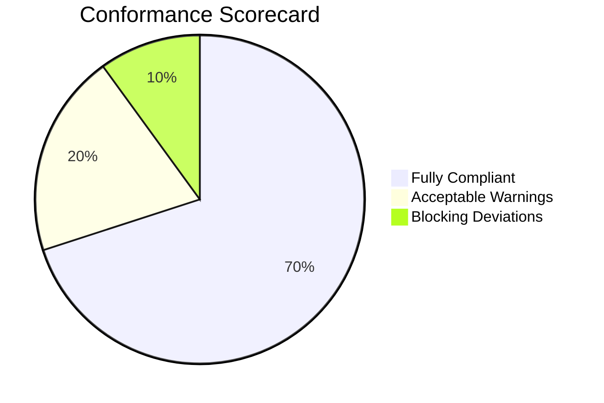

# [Conformance Audit] {Feature / System Name}

**Audit Date:** {YYYY-MM-DD}  
**Auditor:** Antigravity Engineering Drift Auditor  
**Overall Verdict:** 🟢 PASS (Ready for Release) | 🟡 PASS WITH WARNINGS | 🔴 FAIL (Blocked by Critical Drift)  
**Specs Audited:**
- **PRD:** [`docs/prd/{feature-name}-prd.md`](../prd/{feature-name}-prd.md)
- **Tech Design:** [`docs/architecture/{feature-name}-tech-design.md`](../architecture/{feature-name}-tech-design.md)
- **QA Strategy:** [`docs/qa/{feature-name}-test-plan.md`](../qa/{feature-name}-test-plan.md)

---

## 1. Executive Summary & Verdict Scorecard

| Audit Pillar | Status | Blockers (🔴) | Warnings (🟡) | Details |
| :--- | :--- | :--- | :--- | :--- |
| **1. Product & Scope Conformance** | 🟢 Pass | 0 | 0 | All user stories & acceptance criteria accounted for. |
| **2. Architecture & API Contracts** | 🟡 Warning | 0 | 2 | API response field renamed; unindexed foreign key. |
| **3. QA & Test Coverage Gates** | 🟢 Pass | 0 | 0 | Critical path unit and integration test assertions verified. |
| **4. Security & STRIDE Posture** | 🔴 Fail | 1 | 0 | Authentication middleware missing on internal webhook route. |

---

## 2. Detailed Findings & Triage Matrix

### Finding AUD-01: {Title of Deviation}
* **Pillar:** Architecture & API Contracts | Product Scope | QA | Security
* **Severity:** 🔴 Blocker | 🟡 Warning | 🟢 Info
* **Expected in Spec:**
  > Quote or reference from `docs/architecture/` or `docs/prd/`
* **Actual in Codebase:**
  > Code snippet or description with clickable link: [`src/path/to/file.ts#L45-L60`](file:///path/to/file.ts#L45-L60)
* **Root Cause & Impact:** Why this deviation matters (e.g. breaks contract, security loophole, gold-plating).

#### Reconciliation Paths:
- **Option A (Fix Code):** {Instructions on how to change the code to restore compliance with the spec}
- **Option B (Reconcile Spec via ADR):** {Instructions on generating an ADR and updating the spec if the deviation is justified}

---

## 3. Pillar-by-Pillar Verification Breakdown

### 3.1 Product Scope & Acceptance Criteria
- [x] **US-01:** Implemented in [`src/features/...`](file:///)
- [ ] **US-02:** Partially implemented; edge case for timeout omitted.
- [x] **Non-Goals Guard:** No out-of-scope capabilities detected in codebase.

### 3.2 System Architecture, API & Schema Conformance
- [x] Component boundaries respected (no direct DB access from controllers).
- [ ] Endpoint `/api/v1/{resource}` payload matches OpenAPI contract.
- [x] Database migration creates tables matching ERD definitions.

### 3.3 QA & Test Gate Verification
- [x] Unit test suites present for core domain logic.
- [x] Gherkin BDD happy path and error cases mirrored in test files.
- [ ] Concurrency/race condition test missing for idempotency key.

### 3.4 Security & STRIDE Posture
- [x] Input sanitization and parameter validation active.
- [ ] RBAC scope check verified on all mutating endpoints.
- [x] No plaintext credentials or hardcoded tokens in commit history.

---

## 4. Next Steps & Release Gate Sign-Off

To proceed to the **Operations & Rollout Runbook** (`docs/ops/`):
1. Resolve all **🔴 Blocker** findings via code fix or approved emergency ADR.
2. Review **🟡 Warning** findings with Tech Lead.
3. Re-run `engineering-drift-auditor` to achieve a 🟢 PASS verdict.
