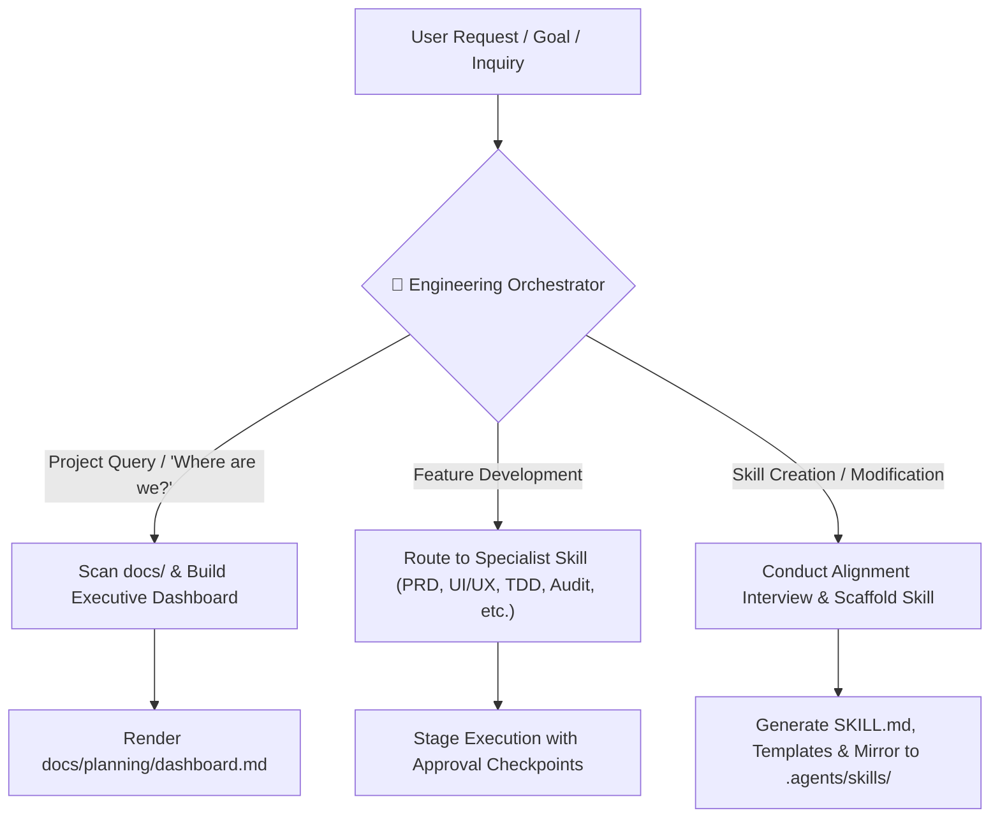

# Engineering Orchestrator & Director Skill

This skill acts as your **Engineering Director and Central Orchestrator**. It is your single point of contact for the entire product and software engineering lifecycle.

Instead of needing to remember every individual skill, you can talk directly to the Orchestrator. It determines where your project currently sits in the pipeline, displays real-time health dashboards, guides you through sequential milestones with approval checkpoints, and manages the meta-evolution of skills (creating, refining, or adapting skills as team needs change).

---

## Workflow Overview

---

## Operating Modes

### Mode 1: Lifecycle State-Machine & Executive Dashboard
When you ask *"Where are we?"*, *"What's the status of the project?"*, or introduce a new feature:
1. **Workspace Inspection:** The orchestrator checks the filesystem for existing artifacts:
   - `docs/prd/` $\rightarrow$ Product Inception
   - `docs/design/` $\rightarrow$ UI/UX Design & Tokens
   - `docs/architecture/` $\rightarrow$ Technical Architecture & RFC
   - `docs/qa/` $\rightarrow$ QA & Test Strategy
   - `docs/planning/` $\rightarrow$ Sprint Backlog & Tasks
   - `src/` & `tests/` $\rightarrow$ Code Execution
   - `docs/audits/` $\rightarrow$ Conformance & Drift Audits
   - `docs/ops/` $\rightarrow$ Launch & Rollout Runbook
2. **Dashboard Generation:** Generates the **Executive Pipeline Dashboard** (using `templates/project-dashboard.md`).
3. **Decisive Recommendation:** Highlights the exact milestone in progress and proposes the immediate next skill to execute.

---

### Mode 2: Guided Pipeline Orchestration with Checkpoints
When driving a feature from concept to production:
1. **Step-by-Step Execution:** Sequentially triggers the specialized skills:
   - `idea-to-prd` $\rightarrow$ `prd-to-uiux-design` $\rightarrow$ `prd-to-tech-design` $\rightarrow$ `qa-test-planner` $\rightarrow$ `spec-to-backlog` $\rightarrow$ `tdd-task-executor` $\rightarrow$ `engineering-drift-auditor` $\rightarrow$ `ops-rollout-runbook`.
2. **Human Approval Checkpoints:** Pauses between critical transitions (e.g. after PRD is drafted, before technical architecture begins; after design spec is drafted, before sprint backlog decomposition) to let you review, edit, and approve before advancing.
3. **Context Chaining:** Seamlessly feeds the artifacts of prior stages into subsequent skills without requiring you to re-explain requirements.

---

### Mode 3: Meta-Skill Evolution (Adding, Editing & Tuning Skills)
When you want to add a new skill, tweak an existing skill, or modify a template:
1. **Interactive Alignment Interview:** Before touching any files, the orchestrator interviews you using structured questions:
   - What is the exact role and responsibility of the new/edited skill?
   - What upstream documents does it read, and what downstream artifacts does it create?
   - What templates or references should be bundled?
2. **Standardized Scaffolding:** Writes the skill conforming strictly to `templates/skill-scaffold.md`:
   - Valid YAML frontmatter.
   - Comprehensive workflow Mermaid diagram.
   - Execution phases with clear rules of engagement.
3. **Workspace Mirroring & Documentation:**
   - Automatically syncs the skill from `skills/<name>/` to `.agents/skills/<name>/`.
   - Updates `README.md` catalog, pipeline diagram, and invocation table.
   - Updates `AGENTS.md` rule to keep the orchestrator aware of the new capability.

---

### Mode 4: Export, Backup & Git Synchronization
When you ask *"Director, export our skills for backup"*, *"Prepare skills for GitHub push"*, or *"Sync skills"*:
1. **Bi-Directional Sync:** Compares `skills/` and `.agents/skills/` to guarantee no local modifications or newly created skills are omitted.
2. **Sanity Verification:** Verifies all YAML frontmatter tags, Mermaid diagrams, and template links.
3. **Automated Git Staging:**
   - Runs `git add skills/ .agents/ AGENTS.md README.md scripts/`
   - Crafts a clear Conventional Commit message summarizing the added or modified skills (e.g. `feat(skills): update tdd-task-executor and export v1.2 suite`).
4. **Push Readiness:** Outputs the status and instructs the user to run `git push origin main` (or executes the push if authentication is configured).
