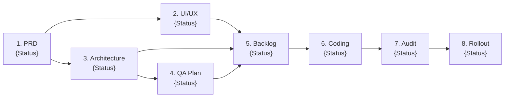

# [Project Health & Status Dashboard] {Feature / Project Name}

**Last Updated:** {YYYY-MM-DD}  
**Lead Orchestrator:** Antigravity Engineering Director  
**Current Milestone / Sprint:** {Sprint X / Milestone Y}

---

## 1. Pipeline Stage & Artifact Status

| # | Pipeline Stage | Artifact Location | Status | Key Deliverable |
| :-: | :--- | :--- | :--- | :--- |
| **1** | **Product Inception** | [`docs/prd/{feature}-prd.md`](../prd/{feature}-prd.md) | ✅ Approved | User stories, KPIs, Non-goals |
| **2** | **UI/UX Design** | [`docs/design/{feature}-design-spec.md`](../design/{feature}-design-spec.md) | 🟡 In Progress | ASCII wireframes, Tokens (`tokens.json`) |
| **3** | **System Architecture** | [`docs/architecture/{feature}-tech-design.md`](../architecture/{feature}-tech-design.md) | ⏳ Pending | Component flow, OpenAPI, ERD |
| **4** | **QA Strategy** | [`docs/qa/{feature}-test-plan.md`](../qa/{feature}-test-plan.md) | ⏳ Pending | Test pyramid, BDD scenarios, SLOs |
| **5** | **Sprint Backlog** | [`docs/planning/{feature}-tasks.md`](../planning/{feature}-tasks.md) | ⏳ Pending | 1-2 day tasks, critical path graph |
| **6** | **Code Execution** | `src/`, `tests/` | ⏳ Pending | Red-Green TDD, Conventional Commits |
| **7** | **Conformance Audit** | [`docs/audits/{feature}-conformance-audit.md`](../audits/{feature}-conformance-audit.md) | ⏳ Pending | 4-Pillar Spec vs. Code audit |
| **8** | **Rollout Runbook** | [`docs/ops/{feature}-runbook.md`](../ops/{feature}-runbook.md) | ⏳ Pending | Canary schedule, feature flag kill-switch |

---

## 2. Sprint Backlog & Code Progress
* **Total Tasks:** {Total}
* **Completed Tasks:** {Completed} ({Percentage}%)
* **In-Flight / Next Task:** `{TASK-ID}: {Task Title}`
* **Blockers:** {None or Description of dependency blocker}

---

## 3. Conformance & Quality Health
* **Open Blockers (🔴):** {Count}
* **Open Warnings (🟡):** {Count}
* **Approved ADRs:** [`docs/adr/`](../adr/)

---

## 4. Next Recommended Action
> **Recommended Step:** Activate `{skill-name}` to {objective}.
