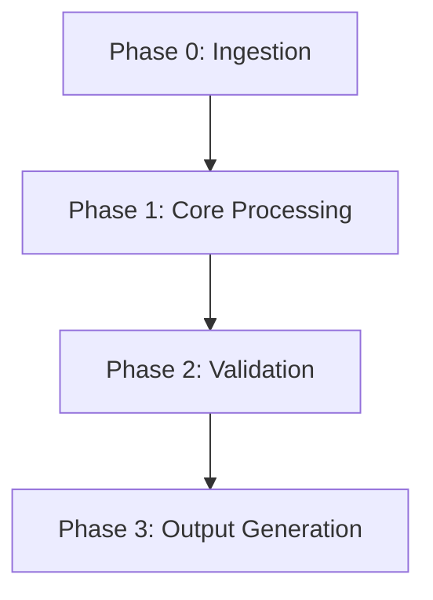

# Skill Scaffolding Standard

When creating or modifying an AI skill in this repository, strictly adhere to the following architecture:

---

## 1. Directory Structure

```text
skills/<skill-name>/
├── SKILL.md                 # Primary instruction file with YAML frontmatter
├── templates/               # (Optional) Markdown/JSON templates output by the skill
│   └── <artifact-template>.md
└── references/              # (Optional) Deep documentation, persona guides, or checklists
    └── <reference-doc>.md
```

---

## 2. SKILL.md Anatomy

```markdown
---
name: <kebab-case-name>
description: >-
  <Concise 1-3 sentence description explaining when to activate this skill
  and what tangible artifact it produces.>
---

# <Human Readable Title> Skill

<Introductory overview of the role and purpose of this skill.>

---

## Workflow Overview



---

## Execution Phases

### Phase 0: Context Ingestion (Hybrid Smart Chaining)
- Auto-discover upstream documents in `docs/`.
- Fall back to interactive questioning if prior docs are absent.

### Phase 1: Core Analysis / Workshop
- Step-by-step instructions guiding the agent.

### Phase 2: Output Generation & Persistence
- Exact target path in workspace (e.g. `docs/<folder>/<feature>-<type>.md`).
- Reference to bundled template in `templates/`.
```

---

## 3. Governance Checklist Before Committing a Skill
1. [ ] Skill directory created under `skills/<skill-name>/`.
2. [ ] `SKILL.md` passes frontmatter format and contains a Mermaid workflow diagram.
3. [ ] Bundled templates placed in `skills/<skill-name>/templates/`.
4. [ ] Mirrored to `.agents/skills/<skill-name>/` for auto-discovery.
5. [ ] Root `README.md` updated with the new skill in the catalog and pipeline diagram.
