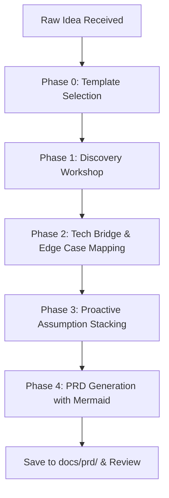

# Idea to PRD: Structured Discovery Skill

This skill guides you through transforming an ambiguous, rough, or abstract product concept into an authoritative, actionable Product Requirements Document (PRD).

It bridges the gap between high-level vision and engineering reality by running an interactive discovery workshop, proposing sensible industry defaults for gaps, and writing the final specification directly to `docs/prd/<feature-name>-prd.md`.

---

## Workflow Overview



---

## Execution Phases

### Phase 0: Template & Scope Selection

When this skill activates, first determine the user's desired depth and format by offering choices:
1. **Modern Agile / Tech PRD (Default)**: Best for standard tech products, startups scaling to production, featuring user stories, Gherkin acceptance criteria, and tech bridge considerations. *(Reference: `templates/modern-agile.md`)*
2. **Lean Startup / Shape Up Pitch**: Best for rapid experiments, MVPs, and timeboxed cycles with tight scope boundaries. *(Reference: `templates/lean-startup.md`)*
3. **Enterprise Deep-Spec**: Best for mission-critical, enterprise, compliance-heavy, or multi-team initiatives. *(Reference: `templates/enterprise-spec.md`)*
4. **Custom**: User provides an existing markdown template.

---

### Phase 1: Multi-Stage Discovery Workshop

Conduct an interactive, focused interview. Avoid asking a massive wall of questions; group questions into concise stages:

1. **The Problem & Who Suffers**:
   - What real-world friction exists today?
   - Who is the primary persona? Who is the buyer vs. end-user?
   - What happens if this problem is not solved?

2. **Core Value Proposition & Differentiator**:
   - What is the single "magic moment" for the user?
   - What is the non-negotiable core capability versus secondary nice-to-haves?

3. **Scope Boundaries (The Scope Hammer)**:
   - What are the explicit **Goals** (In-Scope)?
   - What are the explicit **Non-Goals** (Out-of-Scope) to prevent scope creep?

---

### Phase 2: Technical Bridge & Edge Cases

Translate product mechanics into an engineering-friendly bridge without prescribing micro-level code:

- **Entity & Data Relationships**: High-level data objects and how they connect (drafted with a Mermaid `erDiagram`).
- **User Journey Flow**: Visualized flow of states, branching logic, and permissions (drafted with a Mermaid `flowchart` or `sequenceDiagram`).
- **Interface & Integration Outlines**: Key API boundaries or service interactions.
- **Critical Edge Cases & Failure States**:
  - What happens when external dependencies fail?
  - How does offline / slow network degrade?
  - Concurrency, rate limits, and idempotent operations.
- **Non-Functional Requirements (NFRs)**: Latency, availability, scalability, and security/RBAC guidelines.

---

### Phase 3: Proactive Assumption Stacking

Do not stall momentum waiting for answers to every unknown detail. Instead:
- Proactively supply sensible industry standards and best-practice defaults.
- Clearly tag them as `[Assumption - Needs Validation]`.
- Maintain a dedicated **Assumptions & Open Questions Log** in the PRD, paired with concrete validation actions and recommended owners.

---

### Phase 4: Output Generation

1. **Target File**: Save the completed PRD directly into the workspace at:
   ```
   docs/prd/<feature-name>-prd.md
   ```
   *(Ensure parent directories are created automatically).*
2. **Visuals**: Include at least one Mermaid workflow diagram (`flowchart TD` or `sequenceDiagram`) and one data or state diagram where applicable.
3. **Review**: Present the document link and highlight the top 3 open assumptions that require stakeholder validation before development kicks off.

---

## Rules of Engagement

1. **Be Opinionated, Not Passive**: Suggest strong defaults rather than leaving sections blank.
2. **Gherkin Acceptance Criteria**: Every primary user story must include testable `Given / When / Then` scenarios.
3. **Prevent Scope Creep**: Non-goals are as important as goals. Document what is intentionally left out.
4. **Linkable Files**: Always reference files in the workspace with proper relative markdown links.
