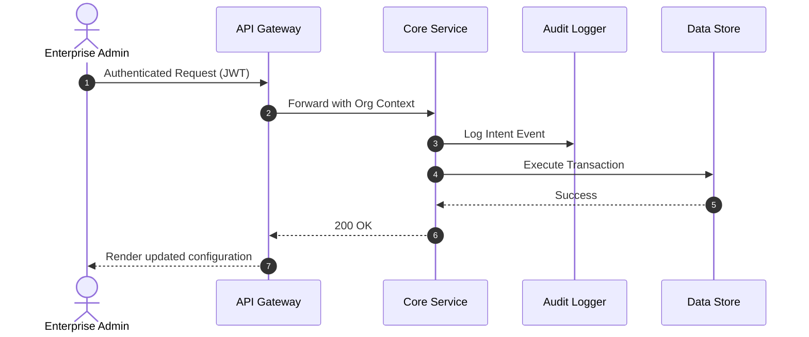

# [Enterprise PRD] {Project / Capability Name}

**Document Control:**
- **Version:** 1.0-DRAFT
- **Security Classification:** Internal / Confidential
- **Target Release:** Q{X} 202{X}
- **Document Path:** `docs/prd/{feature-name}-prd.md`

---

## 1. Business Context & Strategic Alignment
- **Strategic Objective:** Which OKRs / Enterprise strategic pillars does this initiative support?
- **Stakeholders:** Product, Compliance, Legal, InfoSec, Cloud Operations, Enterprise Support.
- **Investment Business Case:** Expected ROI, retention impact, or regulatory requirement.

---

## 2. Requirements Matrix

### 2.1 Functional Requirements (FR)
| Req ID | Capability Description | Priority (P0/P1/P2) | Target Persona | Acceptance Criteria |
| :--- | :--- | :--- | :--- | :--- |
| FR-01 | ... | P0 | Admin | ... |
| FR-02 | ... | P1 | End-User | ... |

### 2.2 Non-Functional Requirements (NFR)
- **Availability / SLA:** 99.95% uptime, multi-region failover.
- **Latency / Performance:** P99 < 500ms under load of 10,000 concurrent RPS.
- **Auditability:** Every state mutation logged to immutable audit trail with actor ID.
- **Data Retention & Sovereignty:** GDPR/CCPA compliance, EU data residency option.

---

## 3. End-to-End System & User Architecture

### 3.1 Interaction Sequence

---

## 4. Security, Privacy & Compliance Assessment
- **Authentication & RBAC:** SSO integration (SAML 2.0 / OIDC), granular role permissions.
- **Data Classification:** PII handling, encryption at rest (AES-256), encryption in transit (TLS 1.3).
- **Disaster Recovery (DR):** RPO < 1 hour, RTO < 4 hours.

---

## 5. Rollout Strategy & Phasing
1. **Phase 1 (Internal Dogfooding):** Deployed to staging and internal sandbox organizations.
2. **Phase 2 (Private Beta / Design Partners):** Whitelisted enterprise pilot accounts.
3. **Phase 3 (General Availability):** Phased canary rollout (5% -> 25% -> 100%).

---

## 6. Assumptions, Risks & Governance Open Questions
| Risk / Assumption | Severity | Mitigation Strategy | Owner / Sign-off |
| :--- | :--- | :--- | :--- |
| Compliance approval required for audit schema | Critical | Review with InfoSec before sprint 2 | Security Lead |
