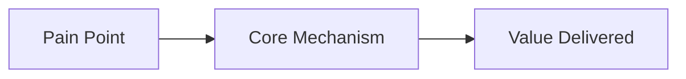

# [Pitch / PRD] {Feature / Solution Name}

**Appetite / Timebox:** {e.g. 2-week cycle, 6-week cycle}  
**Problem Owner:** {Champion / PM}  
**Document Path:** `docs/prd/{feature-name}-prd.md`

---

## 1. The Problem
* Raw facts about the problem (not the solution).
* Who suffers from this and what is the current workaround?
* Why is the current situation unacceptable?

---

## 2. Appetite & Constraints
* How much time and energy are we willing to spend on this? (e.g. Small Batch: 1-2 weeks, Big Batch: 4-6 weeks).
* If it cannot be built in this timeframe, what gets cut?

---

## 3. The Solution & Key Concept
* High-level concept sketch (broad strokes).
* What makes this solution simple and effective?

---

## 4. Boundaries & "No-Gos" (Scope Hammer)
* What are we explicitly **NOT** building?
* What temptations must the engineering team resist during implementation?

---

## 5. Known Rabbit Holes & Technical Risks
* What looks easy but is actually deceptively complex?
* Architectural bottlenecks or third-party quirks.

---

## 6. Assumptions & Immediate Next Steps
| Assumption | Status | Impact if Wrong | Quick Test |
| :--- | :--- | :--- | :--- |
| {Assumption 1} | `[Needs Validation]` | High | {Quick spike / interview} |
