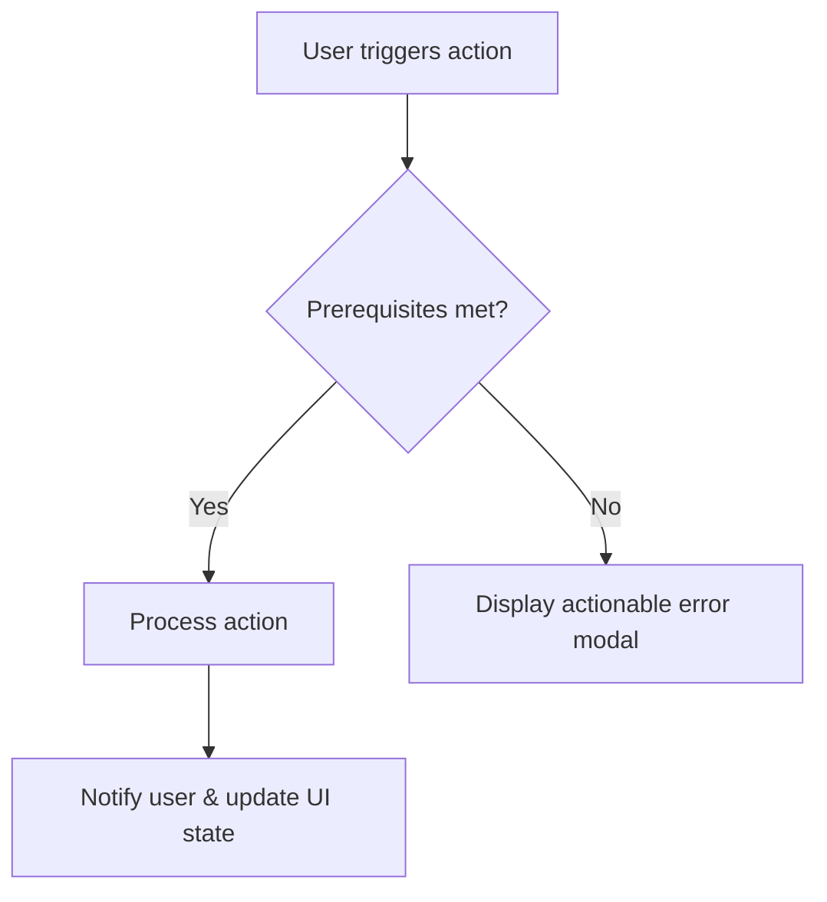
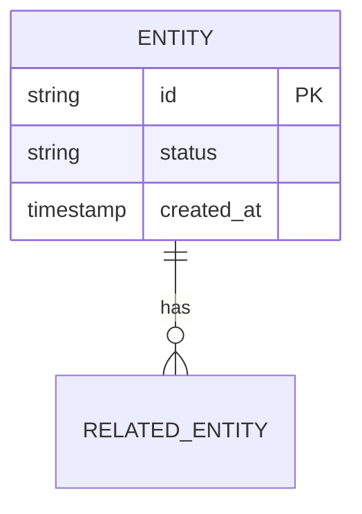

# [PRD] {Feature / Product Name}

**Status:** Draft | In Review | Approved  
**Author(s):** {Author Names / Roles}  
**Target Release / Milestone:** {e.g. Q3 2026 / Sprint 14}  
**Document Path:** `docs/prd/{feature-name}-prd.md`

---

## 1. Executive Summary & Problem Definition

### 1.1 The Core Problem
* What specific user friction or business problem is being addressed?
* Why solve this now? What is the cost of doing nothing?

### 1.2 Target Personas
* **Primary Persona:** {Name/Role, pain points, core JTBD (Jobs To Be Done)}
* **Secondary Persona:** {Stakeholders, internal operators, secondary users}

### 1.3 Goals & Non-Goals
* **Goals (In-Scope):**
  - [ ] Goal 1...
  - [ ] Goal 2...
* **Non-Goals (Explicitly Out-of-Scope):**
  - Explicitly excluded feature 1...
  - Future phase consideration...

---

## 2. Success Metrics & KPIs

| Metric | Baseline | Target (Post-Launch) | Measurement Method |
| :--- | :--- | :--- | :--- |
| e.g. User Adoption | 0% | 35% within 30 days | Event tracking (`user_opt_in`) |
| e.g. Workflow Completion Time | 4m 12s | < 1m 30s | Client timing telemetry |
| e.g. Support Ticket Volume | N/A | < 2% of total users | Zendesk tag analysis |

---

## 3. User Journeys & Experience Workflow

### 3.1 Primary Workflow Diagram (Mermaid)

### 3.2 Step-by-Step Experience Walkthrough
1. **Trigger:** How the user enters this feature.
2. **Interaction:** What choices they make and feedback received.
3. **Completion:** State transition, feedback, persistence.

---

## 4. Functional Requirements & User Stories

### US-01: {User Story Title}
* **Story:** As a `{user role}`, I want to `{action / capability}` so that `{benefit / outcome}`.
* **Acceptance Criteria (Gherkin format):**
  - **Given** {precondition}
  - **When** {action taken}
  - **Then** {expected outcome}
* **Edge Cases & Failure Handling:**
  - Network timeout: {behavior}
  - Invalid input: {validation rule}

### US-02: {User Story Title}
* **Story:** ...
* **Acceptance Criteria:** ...

---

## 5. Technical & Engineering Considerations (Bridge)

### 5.1 High-Level Data Model / Entity Overview

### 5.2 API Contract Outlines
- `POST /api/v1/{resource}` - Trigger creation
- `GET /api/v1/{resource}/{id}` - Fetch status and detail

### 5.3 Non-Functional Requirements (NFRs)
- **Performance:** P95 response latency < 200ms.
- **Security & Privacy:** Data encrypted at rest and in transit; RBAC enforced.
- **Reliability & Scalability:** Graceful degradation on 3rd party dependency failure.

---

## 6. Assumptions & Open Questions Log

### 6.1 Proactive Assumptions Stack
| ID | Area | Assumption | Confidence | Validation Action / Owner |
| :--- | :--- | :--- | :--- | :--- |
| A-01 | Architecture | Existing auth service supports new scope tokens | Medium | Verify with Platform Team |
| A-02 | UX | Users prefer inline editing over modal dialogs | High | Confirm during usability tests |

### 6.2 Risks & Dependencies
- **Risk:** Dependency on third-party API rate limits.
  - *Mitigation:* Implement caching and background job queueing.
