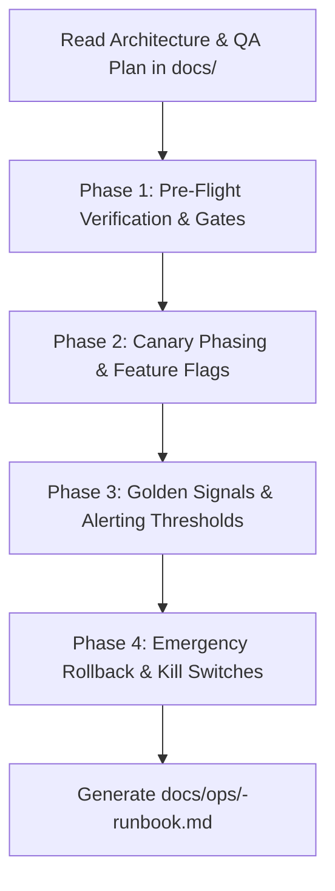

# Operations, Launch & Rollout Runbook Skill

This skill prepares engineering teams for safe, predictable production deployments. It bridges the gap between completed code/tests and live operations by generating a comprehensive **Operations & Rollout Runbook**.

It answers **how to deploy, observe, and safely abort** the release without downtime or data corruption.

---

## Workflow Overview



---

## Execution Phases

### Phase 0: Context Ingestion (Hybrid Smart Chaining)
1. **Auto-Discovery:**
   - Scan `docs/architecture/` for components, migration strategies, and external dependencies.
   - Scan `docs/qa/` for performance benchmarks and SLO targets.
2. **Fallback:** If prior docs are missing, prompt the user for:
   - Target deployment environments and tools (Kubernetes, AWS/GCP, Docker).
   - Feature flag tool (LaunchDarkly, Unleash, internal config).
   - Critical telemetry dashboards and on-call alerting tools.

---

### Phase 1: Pre-Flight Verification & Gates
Establish strict deployment checklists:
- Database migration dry-run verifications.
- Provisioning secrets, API keys, and environment variables.
- Verifying backward compatibility and dependent service health.

---

### Phase 2: Canary Phasing & Feature Flags
Structure the rollout into safe, progressive cohorts:
- **Phase 0:** Internal dogfooding (100% staff / synthetic accounts).
- **Phase 1:** Canary release (1-5% user base with soak period).
- **Phase 2:** Staged expansion (25% $\rightarrow$ 50% $\rightarrow$ 100%).
- Criteria to advance between each phase.

---

### Phase 3: Golden Signals Observability & Alerting
Define monitoring metrics and alert policies:
- **Latency:** P95/P99 thresholds triggering alerts.
- **Traffic:** RPS expectations and baseline deviation alarms.
- **Errors:** 5xx error rate ceilings (e.g. $> 0.1\%$ warning, $> 1.0\%$ critical).
- **Saturation:** CPU, memory, connection pools, and queue backlogs.

---

### Phase 4: Rollback & Kill-Switch Playbook
Document exact, fast-acting procedures to abort if an incident occurs:
- Immediate feature flag kill-switch procedure ($< 30\text{ seconds}$).
- Application binary rollback steps (`kubectl rollout undo`).
- Safe database migration rollback without dropping live columns.
- Clear escalation matrix with on-call roles.

---

### Phase 5: Output Generation
1. Write the completed runbook to:
   ```
   docs/ops/<feature-name>-runbook.md
   ```
2. Reference the template at `templates/runbook.md`.
3. Provide the user with a direct link and a 1-page summary of the emergency kill-switch steps.
