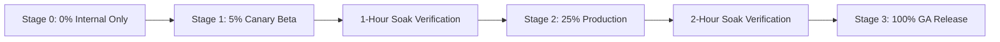

# [Operations & Rollout Runbook] {Feature / Release Name}

**PRD Reference:** [`docs/prd/{feature-name}-prd.md`](../prd/{feature-name}-prd.md)  
**Tech Design Reference:** [`docs/architecture/{feature-name}-tech-design.md`](../architecture/{feature-name}-tech-design.md)  
**QA Plan Reference:** [`docs/qa/{feature-name}-test-plan.md`](../qa/{feature-name}-test-plan.md)  
**Release Commander:** {Name / On-Call SRE}  
**Target Release Date:** {YYYY-MM-DD}  
**Document Path:** `docs/ops/{feature-name}-runbook.md`

---

## 1. Pre-Flight Verification & Launch Gates

### 1.1 Pre-Deployment Checklist
- [ ] Code merged to `main` with passing CI/CD checks (lint, unit, integration).
- [ ] Database migrations executed in staging and dry-run verified on replica.
- [ ] Feature flag created in LaunchDarkly / Unleash with default state `OFF`.
- [ ] Secret credentials / environment variables provisioned in production Vault/K8s.
- [ ] Monitoring dashboard active; alerting channels verified in Slack / PagerDuty.
- [ ] Support and internal ops teams notified of release window.

---

## 2. Feature Flag & Canary Rollout Strategy



### 2.1 Rollout Phasing Schedule
| Stage | Percentage / Cohort | Soak Duration | Exit / Advancement Criteria |
| :--- | :--- | :--- | :--- |
| **Stage 0** | Internal Employees / Dogfood | 24 Hours | 0 regression reports; successful smoke test |
| **Stage 1** | 5% Production Traffic (Random or Pilot orgs) | 1 Hour | Error rate $< 0.05\%$; P95 latency normal |
| **Stage 2** | 25% Production Traffic | 2 Hours | DB CPU $< 60\%$; no memory leaks detected |
| **Stage 3** | 100% General Availability (GA) | Permanent | Full SLA compliance for 24 hours |

---

## 3. Observability & Golden Signals Telemetry

### 3.1 Live Monitoring Dashboards
- **Grafana URL:** `https://grafana.internal/d/{feature-dashboard}`
- **Datadog / Honeycomb Board:** `https://app.datadoghq.com/dashboard/{id}`

### 3.2 Service Level Objectives (SLOs) & Critical Alerts
| Golden Signal | Metric Name | Warning Threshold | Critical / Page Threshold |
| :--- | :--- | :--- | :--- |
| **Latency** | `http_request_duration_seconds{quantile="0.95"}` | $> 250\text{ms}$ (5m avg) | $> 500\text{ms}$ (2m avg) |
| **Traffic** | `rate(http_requests_total[5m])` | Unexpected $\pm 50\%$ swing | Drop to 0 RPS |
| **Errors** | `rate(http_requests_total{status=~"5.."}[5m]) / total` | $> 0.1\%$ | $> 1.0\%$ |
| **Saturation** | `container_cpu_usage_rate` / `db_connections_active` | $> 75\%$ capacity | $> 90\%$ capacity |

---

## 4. Rollback & Abort Playbook

> [!CAUTION]
> If any critical threshold is breached during any rollout stage, trigger an immediate rollback. Do NOT attempt to "hotfix forward" during an active outage.

### 4.1 Kill Switch Procedure (Immediate - < 30 seconds)
1. Navigate to the Feature Flag Management Dashboard:
   - URL: `https://flags.internal/features/{feature-flag-key}`
2. Toggle the master switch to **`OFF`**.
3. Clear edge/CDN cache if payload mutations were client-cached:
   ```bash
   curl -X POST https://api.internal/v1/cache/purge -H "Authorization: Bearer $PURGE_TOKEN"
   ```

### 4.2 Application Binary Revert (< 5 minutes)
If the regression is caused by non-flagged infrastructure or worker changes:
```bash
# Revert K8s deployment to previous stable revision
kubectl rollout undo deployment/{service-name} -n production
kubectl rollout status deployment/{service-name} -n production
```

### 4.3 Database Schema Rollback Guidelines
- If running under Expand/Contract migration, the new columns are non-breaking. **Do not drop columns immediately.**
- Revert application traffic to read from legacy fields.
- Schedule cleanup/contract migration in the next scheduled maintenance window.

---

## 5. Incident Response & Escalation Matrix

| Role | Contact / Handle | PagerDuty Schedule |
| :--- | :--- | :--- |
| **Release Commander** | `@release-lead` | Primary Deployment On-Call |
| **Tech Lead / Service Owner** | `@core-eng-lead` | Tier 2 Escalation |
| **Database Administrator (DBA)** | `@dba-oncall` | Database / Storage Escalation |
| **Customer Support Champion** | `@support-lead` | External Communication Liaison |
