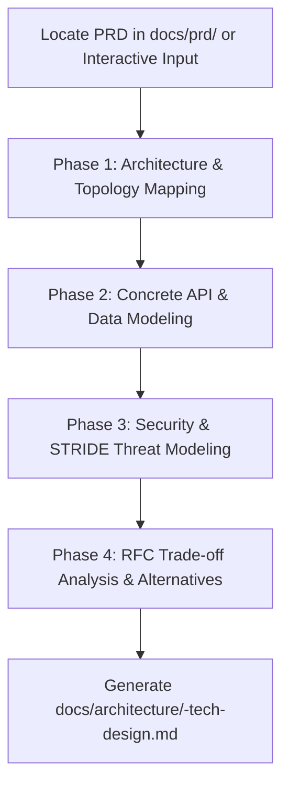

# PRD to Technical Design & Architecture Skill

This skill translates product intent into robust engineering architecture. It inspects an existing PRD (or accepts feature requirements interactively) and generates an authoritative **Technical Design Document (TDD / RFC)**.

It answers **how** the system will be built, specifying components, API contracts, database schemas, security posture, and architectural trade-offs.

---

## Workflow Overview



---

## Execution Phases

### Phase 0: Context Ingestion (Hybrid Smart Chaining)
1. **Auto-Discovery:** Scan `docs/prd/` for existing PRDs.
   - If found, read the latest PRD to extract goals, user stories, non-goals, and technical constraints.
   - Summarize the ingested PRD context to the user for validation.
2. **Fallback:** If no PRD file exists, prompt the user for the core problem statement, system boundaries, and expected volume/scale.

---

### Phase 1: System Architecture & Component Mapping
- **Component Breakdown:** Identify services (e.g. API Gateway, Core Backend, Asynchronous Workers, Caches, Message Queues).
- **Communication Protocols:** Synchronous (gRPC / HTTP REST) vs. Asynchronous (Kafka / RabbitMQ / SQS events).
- **Visual Architecture:** Generate a clean Mermaid `flowchart TD` representing the overall physical and logical boundaries.

---

### Phase 2: Concrete API Contracts & Data Models
Do not leave contracts as vague bullet points:
- **API Spec:** Draft endpoint paths, HTTP verbs, required headers (e.g. `Idempotency-Key`, `Authorization`), and concrete OpenAPI 3.0/3.1 YAML/JSON payload snippets.
- **Sequence Diagram:** Model core success and failure flows with a Mermaid `sequenceDiagram`.
- **Database Model (ERD):** Model entities, keys, and foreign-key relationships using a Mermaid `erDiagram`.
- **Schema & Indexes:** Provide concrete SQL DDL or NoSQL schema blocks, specifying primary access indexes.
- **Zero-Downtime Migration:** Outline the Expand/Contract migration phases for existing data.

---

### Phase 3: Security & Threat Modeling (STRIDE)
Analyze security implications using the STRIDE methodology:
- **Spoofing & Auth:** Token validation, public key distribution (JWKS), session lifetimes.
- **Tampering & Encryption:** In-transit (TLS 1.3), at-rest (AES-256), and field-level encryption for PII.
- **Repudiation & Audit:** Immutable audit logging for mutations.
- **Information Disclosure:** Multi-tenant boundary isolation and data masking.
- **Denial of Service:** Tiered rate limiting, request size limits, connection timeouts.
- **Elevation of Privilege:** Role-based access control (RBAC) checks on every controller.

---

### Phase 4: RFC Trade-Off Analysis
Document engineering decisions explicitly:
- Compare the **Chosen Approach** vs. **Rejected Alternatives** (e.g. Relational vs. Document Store, Sync HTTP vs. Event-driven).
- Document why the alternatives were rejected (latency, complexity, maintenance overhead).

---

### Phase 5: Output Generation
1. Write the final document to:
   ```
   docs/architecture/<feature-name>-tech-design.md
   ```
2. Reference the template at `templates/tech-design.md`.
3. Provide the user with a direct link and highlight any necessary **engineering spikes** before coding begins.
