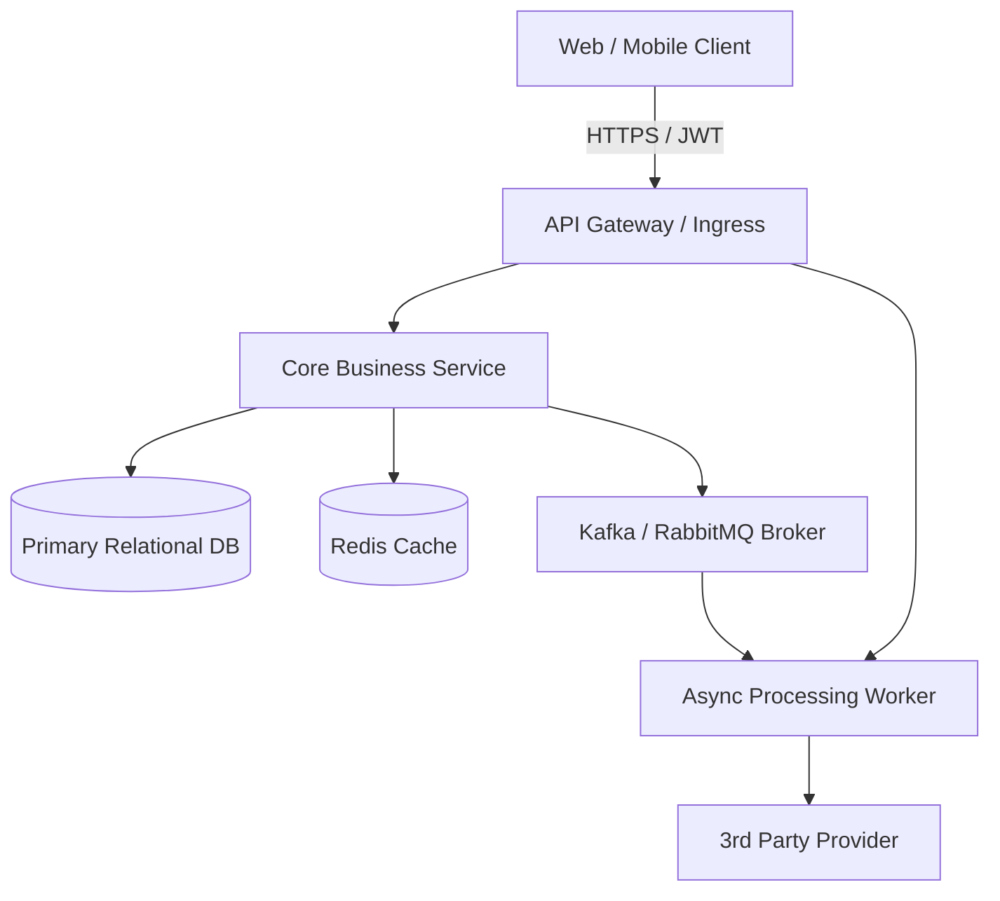
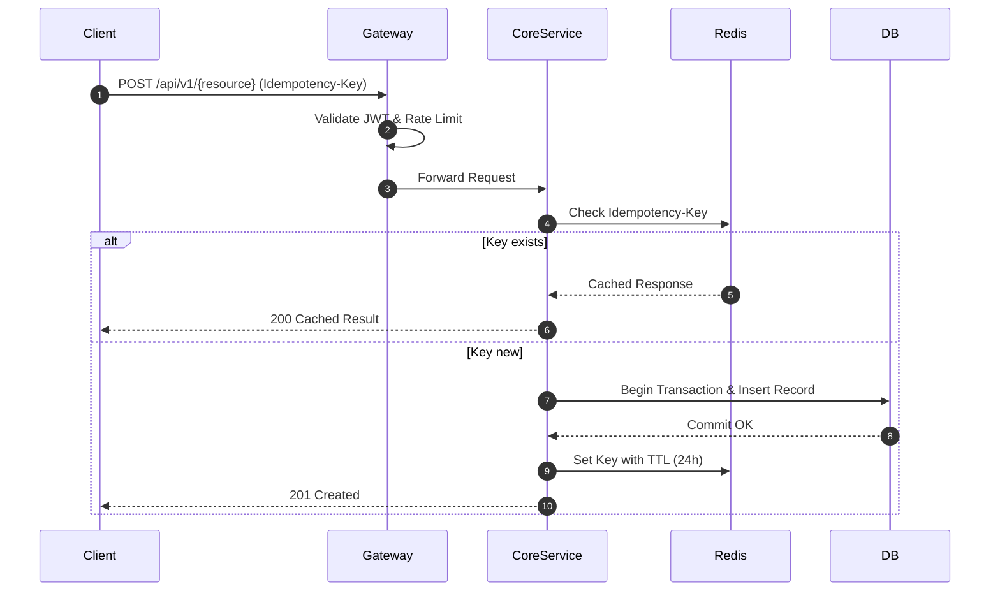
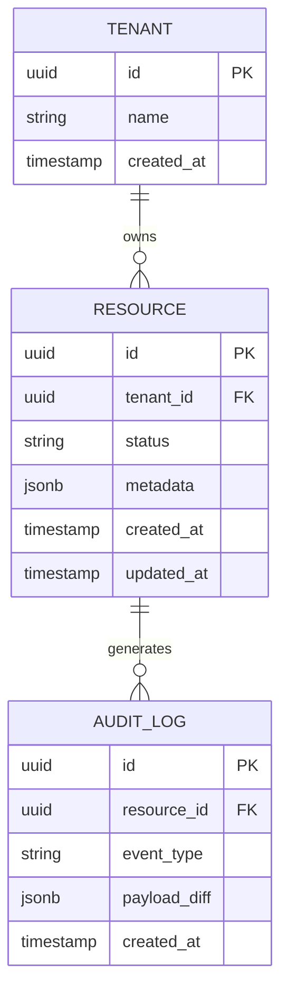

# [Technical Design Doc / RFC] {System / Feature Name}

**PRD Reference:** [`docs/prd/{feature-name}-prd.md`](../prd/{feature-name}-prd.md)  
**Author(s):** {Tech Lead / Engineer}  
**Status:** In Review | Approved | Deprecated  
**Target Milestone:** {e.g. Q3 2026 / Sprint 15}  
**Document Path:** `docs/architecture/{feature-name}-tech-design.md`

---

## 1. Context & Architectural Overview

### 1.1 Context & Business Drivers
* Brief recap of the problem from the PRD and engineering motivations.
* High-level architectural approach and key constraints (e.g. multi-tenant isolation, backward compatibility).

### 1.2 System Architecture Diagram


### 1.3 Component Responsibilities
| Component | Primary Responsibility | Tech Stack / Framework | Scaling Tier |
| :--- | :--- | :--- | :--- |
| `API Gateway` | Authentication, rate limiting, routing | Envoy / Kong | Stateless, horizontal auto-scaling |
| `Core Business Service` | Business logic, state machines, transactions | Go / Node.js / Python | Horizontal pod autoscaling (HPA) |
| `Worker Service` | Background tasks, batching, webhooks | Rust / Go | Queue-depth driven scaling |

---

## 2. Interface Contracts & API Specifications

### 2.1 API Endpoints Summary
| Method | Path | Auth / Scopes | Description | Idempotent |
| :--- | :--- | :--- | :--- | :--- |
| `POST` | `/api/v1/{resource}` | `write:{resource}` | Creates a new record | Yes (`Idempotency-Key`) |
| `GET` | `/api/v1/{resource}/{id}` | `read:{resource}` | Fetches record with cached state | Yes |
| `PATCH` | `/api/v1/{resource}/{id}` | `write:{resource}` | Partial mutation | No |

### 2.2 Concrete API Payload Contracts (OpenAPI Format)
```yaml
paths:
  /api/v1/{resource}:
    post:
      summary: Create {resource}
      parameters:
        - in: header
          name: Idempotency-Key
          schema:
            type: string
            format: uuid
          required: true
      requestBody:
        required: true
        content:
          application/json:
            schema:
              type: object
              required: [name, tenant_id]
              properties:
                name:
                  type: string
                  minLength: 3
                tenant_id:
                  type: string
                  format: uuid
      responses:
        '201':
          description: Created successfully
          content:
            application/json:
              schema:
                $ref: '#/components/schemas/ResourceResponse'
        '400':
          $ref: '#/components/responses/ValidationError'
        '409':
          description: Conflict or concurrent modification
```

### 2.3 Interaction Flow Sequence


---

## 3. Data Model & Database Migration Plan

### 3.1 Entity Relationship Diagram (ERD)


### 3.2 Concrete Database Schema (DDL)
```sql
CREATE TABLE IF NOT EXISTS resources (
    id UUID PRIMARY KEY DEFAULT gen_random_uuid(),
    tenant_id UUID NOT NULL REFERENCES tenants(id) ON DELETE CASCADE,
    name VARCHAR(255) NOT NULL,
    status VARCHAR(50) NOT NULL DEFAULT 'draft',
    metadata JSONB DEFAULT '{}'::jsonb,
    created_at TIMESTAMPTZ NOT NULL DEFAULT NOW(),
    updated_at TIMESTAMPTZ NOT NULL DEFAULT NOW()
);

-- Access Pattern Indexes
CREATE INDEX IF NOT EXISTS idx_resources_tenant_status 
ON resources (tenant_id, status) 
INCLUDE (name, created_at);
```

### 3.3 Zero-Downtime Migration Strategy (Expand/Contract)
1. **Phase 1 (Expand):** Add nullable columns or new tables with backward-compatible defaults.
2. **Phase 2 (Dual-Write/Backfill):** Application writes to both schema versions while background job backfills old rows.
3. **Phase 3 (Contract):** Switch reads to new schema, remove deprecated columns safely.

---

## 4. Trade-Off Analysis & Architectural RFC Decisions

| Decision Area | Chosen Approach | Rejected Alternative | Reason & Trade-Off |
| :--- | :--- | :--- | :--- |
| **Storage Engine** | PostgreSQL with JSONB | MongoDB / Document DB | Strong relational ACID guarantees for billing/tenancy outweigh document flexibility. |
| **Communication** | Async Kafka events | Synchronous REST HTTP | Prevents cascade timeouts across downstream services during traffic spikes. |
| **Caching Layer** | Redis Read-Through with TTL | In-Memory Local Cache | Preserves cache coherence across horizontally scaled stateless replicas. |

---

## 5. Security & Threat Modeling (STRIDE)

- **Spoofing / Identity:** JWT tokens validated via public JWKS at the API Gateway; expired tokens rejected before hitting backend.
- **Tampering:** Data signed and encrypted in transit (TLS 1.3); DB fields containing PII encrypted with AES-GCM-256.
- **Repudiation:** Audit log written for all state mutations with immutable append-only storage.
- **Information Disclosure:** Tenant isolation enforced via database row-level security (RLS) or tenant-keyed query decorators.
- **Denial of Service:** Tiered rate limiting (Token Bucket) per IP and per API key.
- **Elevation of Privilege:** RBAC permissions checked on every single endpoint controller.

---

## 6. Open Engineering Questions & Spikes
| ID | Question / Unknown | Impact | Spike Owner & Timebox |
| :--- | :--- | :--- | :--- |
| S-01 | Will JSONB indexing handle 50M rows under 100ms? | Performance | Run load benchmark on staging DB (2 days) |
| S-02 | Third-party webhook retry backoff policy | Resilience | Verify rate limits with vendor docs (1 day) |
