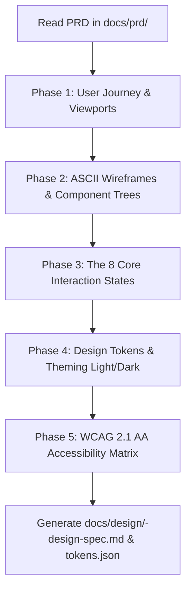

# PRD to UI/UX Design & Design Systems Skill

This skill acts as the **Product Designer & Design Systems Lead** in your software development pipeline. It takes an approved PRD from `docs/prd/` and creates an authoritative **UI/UX Design Specification** before frontend coding begins.

It eliminates UI ambiguity by detailing screen layouts (ASCII wireframes), user journeys, component hierarchy trees, the 8 core interaction states (Idle, Hover, Active, Focus, Disabled, Loading/Skeleton, Empty, Error), framework-agnostic design tokens with Tailwind mappings, and WCAG 2.1 AA accessibility standards.

---

## Workflow Overview



---

## Execution Phases

### Phase 0: Context & Persona Ingestion
1. Automatically scan `docs/prd/<feature>-prd.md` to extract:
   - Target personas, user pain points, and primary JTBD (Jobs To Be Done).
   - Core user workflows and user stories.
   - Non-goals (UI elements that should intentionally NOT be designed).
2. If no PRD file exists, prompt the user for the primary user goal, target screen types (Desktop, Mobile, Tablet), and branding mood.

---

### Phase 1: Information Architecture & User Journeys
- **Journey Mapping:** Model user decision trees and screen transitions using a Mermaid `flowchart TD`.
- **Responsive Viewport Specs:** Define layout behavior across Mobile ($375\text{px}$), Tablet ($640\text{px}$), and Desktop ($\ge 1024\text{px}$).

---

### Phase 2: ASCII Wireframes & Component Hierarchy
- **Visual ASCII Wireframes:** Draft text-based wireframe layouts representing every primary screen and modal/drawer state.
- **Component Hierarchy Tree:** Model parent-to-child component nesting using a Mermaid `graph TD` (e.g. `AppShell -> Header -> SearchBar`).

---

### Phase 3: The 8 Core Interaction States
For every interactive component (buttons, inputs, cards, data tables, modals), explicitly document all 8 states:
1. **Default (Idle):** Resting appearance.
2. **Hover:** Elevation, contrast, or color shift ($\approx 10\%$).
3. **Active (Pressed):** Scale depression or deeper shade indicating click.
4. **Focus Visible:** Distinct 2px outline for keyboard tab navigation.
5. **Disabled:** 50% opacity, non-interactive, `cursor: not-allowed`.
6. **Loading / Skeleton:** Pulsing shimmer placeholders and button spinners.
7. **Empty State:** Friendly graphic, explanatory title, and primary CTA.
8. **Error / Validation:** Red accent, warning icon, and contextual guidance text.

---

### Phase 4: Design Tokens & Theming (Dual Format)
- **Framework-Agnostic Tokens:** Output standard W3C Design Tokens JSON values for colors, typography scales, spacing units, and border radiuses.
- **Tailwind & CSS Variable Equivalents:** Map each token to both a CSS custom property (`--color-primary`) and its standard Tailwind utility class (`bg-indigo-600 dark:bg-indigo-500`).
- **Dark Mode Support:** Provide semantic light and dark mode pairings for surfaces, text, borders, and accents.

---

### Phase 5: WCAG 2.1 AA Accessibility
- **Contrast Ratios:** Verify $\ge 4.5:1$ text contrast ratio against background surfaces.
- **Keyboard Tab Order:** Sequential navigation order and skip-to-content links.
- **Screen Reader Semantics:** Standard ARIA roles (`role="dialog"`, `aria-expanded`, `aria-invalid`, `aria-describedby`).
- **Motion Reduction:** Media query specification for `prefers-reduced-motion`.

---

### Phase 6: Output Generation
1. Write the completed design specification to:
   ```
   docs/design/<feature-name>-design-spec.md
   ```
   *(Referencing `templates/design-spec.md`).*
2. Save the design tokens JSON file to:
   ```
   docs/design/tokens.json
   ```
   *(Referencing `templates/tokens.json`).*
3. Provide the user with clickable links and highlight how the frontend engineer persona in `tdd-task-executor` will use these specs during development.
