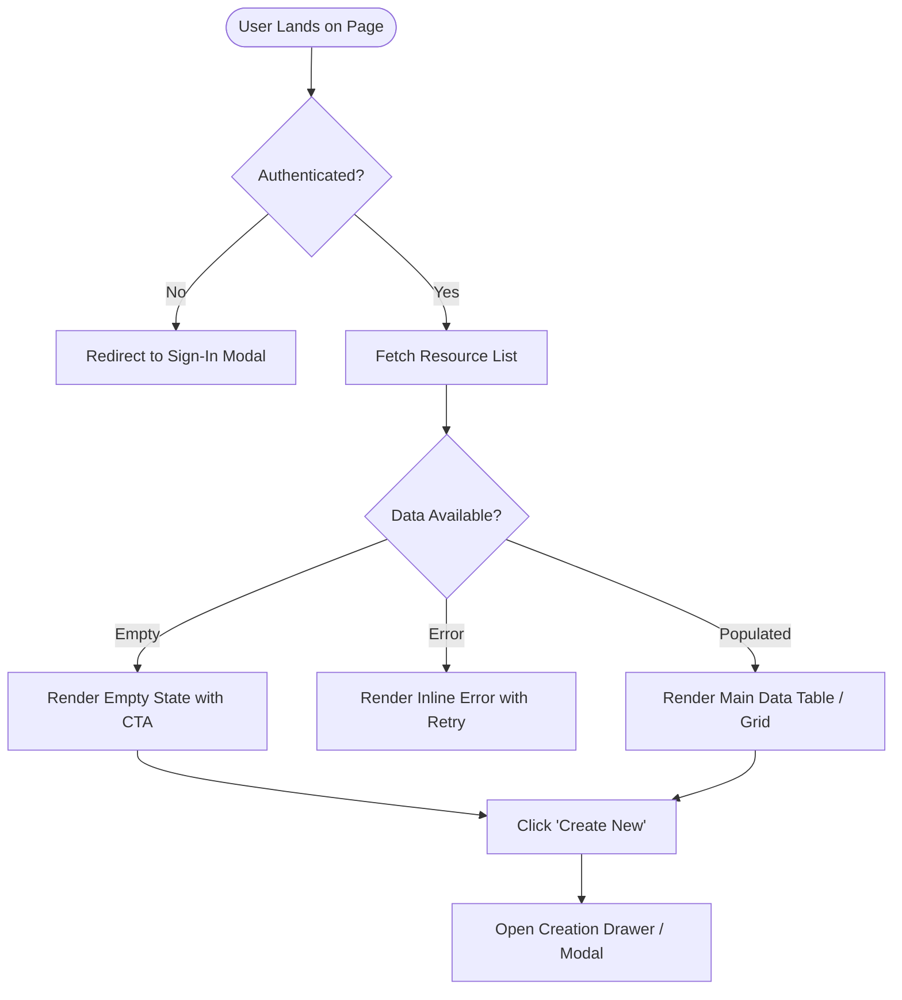
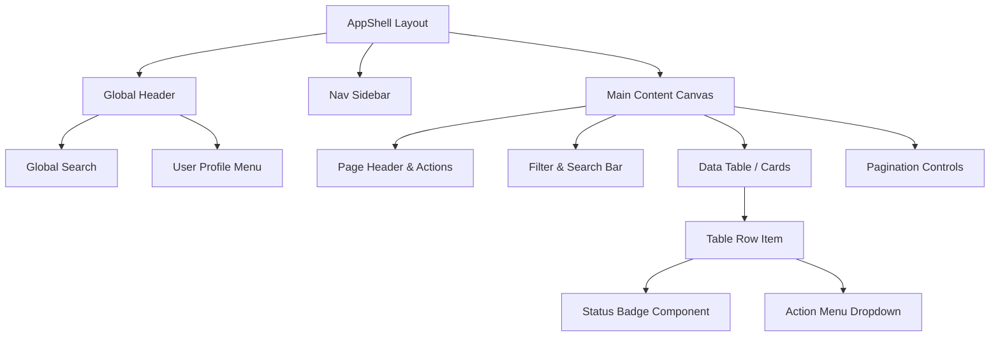

# [UI/UX Design Specification] {Feature / Interface Name}

**PRD Reference:** [`docs/prd/{feature-name}-prd.md`](../prd/{feature-name}-prd.md)  
**Author(s):** {Product Designer / UX Lead}  
**Status:** In Review | Approved  
**Design Tokens Reference:** [`docs/design/tokens.json`](tokens.json)  
**Document Path:** `docs/design/{feature-name}-design-spec.md`

---

## 1. Information Architecture & User Journey Flow

### 1.1 User Journey Diagram (Mermaid)


### 1.2 Viewport & Device Breakpoints
| Breakpoint | Minimum Width | Target Devices | Layout Behavior |
| :--- | :--- | :--- | :--- |
| **Mobile (`sm`)** | $375\text{px} - 639\text{px}$ | iPhone, Android phones | Single-column stacked, bottom navigation sheet, full-width inputs |
| **Tablet (`md`)** | $640\text{px} - 1023\text{px}$ | iPad, Tablets | Collapsible sidebar, 2-column card grid |
| **Desktop (`lg/xl`)** | $\ge 1024\text{px}$ | Laptops, Desktop monitors | Fixed left sidebar, multi-column data tables, modal dialogs |

---

## 2. Screen Layouts & Visual Wireframes (ASCII)

### 2.1 Primary Dashboard / Screen Wireframe
```text
+------------------------------------------------------------------------------------+
|  [Logo] AppName           [Search resources...]                (🔔) [Avatar: User] |
+------------------------------------------------------------------------------------+
| SIDEBAR       | BREADCRUMBS: Home / Resources                                      |
|               |                                                                    |
| [🏠 Overview] | Resources Management                      [+ Create Resource (CTA)]|
| [📦 Inventory]| Filter by: [Status: All v]  [Sort: Newest v]  [Search input......] |
| [⚙️ Settings] |--------------------------------------------------------------------|
|               | [ ] NAME          | STATUS   | CREATED       | ACTIONS             |
|               |--------------------------------------------------------------------|
|               | [ ] Production-01 | [Active] | Nov 07, 2026  | [Edit] [Delete] ... |
|               | [ ] Staging-Test  | [Paused] | Nov 05, 2026  | [Edit] [Delete] ... |
|               | [ ] Legacy-Sync   | [Draft]  | Oct 28, 2026  | [Edit] [Delete] ... |
|               |--------------------------------------------------------------------|
|               | Showing 1-10 of 42 records              [< Prev] [1] [2] [3] [Next>]|
+------------------------------------------------------------------------------------+
```

### 2.2 Creation Drawer / Modal Wireframe
```text
+---------------------------------------------------+
| Create New Resource                           [X] |
+---------------------------------------------------+
| Name *                                            |
| [ Production Database Cluster                   ] |
| Helper: Enter a unique identifier (min 3 chars).  |
|                                                   |
| Environment *                                     |
| (o) Production   ( ) Staging   ( ) Development    |
|                                                   |
| Description (Optional)                            |
| +-----------------------------------------------+ |
| | Primary relational storage cluster...         | |
| +-----------------------------------------------+ |
|                                                   |
| [!] Error alert placeholder (if validation fails) |
+---------------------------------------------------+
|                              [Cancel]  [Create (Primary)]
+---------------------------------------------------+
```

---

## 3. Component Hierarchy Tree



---

## 4. The 8 Core Interaction States

Every interactive component (Buttons, Inputs, Cards, Tables) must support these 8 states:

| State | Visual Behavior & Feedback | Framework Utility / CSS Class |
| :--- | :--- | :--- |
| **1. Default (Idle)** | Resting state with standard surface and border colors. | `bg-primary-600 text-white border-transparent` |
| **2. Hover** | Subtle elevation or brightness shift ($\approx 10\%$). Cursor: `pointer`. | `hover:bg-primary-700 hover:shadow-sm` |
| **3. Active / Pressed** | Depressed scale or darker shade indicating physical press. | `active:scale-[0.98] active:bg-primary-800` |
| **4. Focus Visible** | Distinct 2px outline for keyboard accessibility. | `focus-visible:outline-2 focus-visible:outline-primary-500 focus-visible:outline-offset-2` |
| **5. Disabled** | 50% opacity, non-interactive. Cursor: `not-allowed`. | `opacity-50 cursor-not-allowed pointer-events-none` |
| **6. Loading / Skeleton** | Pulsing shimmer block replacing text; spinner inside button. | `animate-pulse bg-slate-200 dark:bg-slate-700` |
| **7. Empty State** | Illustrated graphic, descriptive title, and primary CTA. | Centered column with friendly iconography |
| **8. Error / Validation** | Crimson border, error icon, and descriptive inline hint. | `border-danger-500 text-danger-600 focus:ring-danger-500` |

---

## 5. Design Tokens & Theming Specification

### 5.1 Dual Representation (CSS Variables & Tailwind Mapping)

| Token Name | Light Mode Value | Dark Mode Value | Tailwind Class Equivalent |
| :--- | :--- | :--- | :--- |
| `--color-brand-primary` | `#4f46e5` (Indigo 600) | `#6366f1` (Indigo 500) | `bg-indigo-600 dark:bg-indigo-500` |
| `--color-surface-base` | `#ffffff` (White) | `#0f172a` (Slate 900) | `bg-white dark:bg-slate-900` |
| `--color-surface-subtle` | `#f8fafc` (Slate 50) | `#1e293b` (Slate 800) | `bg-slate-50 dark:bg-slate-800` |
| `--color-text-main` | `#0f172a` (Slate 900) | `#f8fafc` (Slate 50) | `text-slate-900 dark:text-slate-50` |
| `--color-text-muted` | `#64748b` (Slate 500) | `#94a3b8` (Slate 400) | `text-slate-500 dark:text-slate-400` |
| `--color-feedback-danger` | `#ef4444` (Red 500) | `#f87171` (Red 400) | `text-red-500 dark:text-red-400` |
| `--radius-card` | `8px` (`0.5rem`) | `8px` (`0.5rem`) | `rounded-lg` |
| `--font-sans` | `Inter, sans-serif` | `Inter, sans-serif` | `font-sans` |

---

## 6. Accessibility & WCAG 2.1 AA Compliance Matrix

- **Color Contrast:** All body text maintains $\ge 4.5:1$ contrast against backgrounds; large text maintains $\ge 3:1$.
- **Keyboard Navigation (Tab Order):**
  1. Skip link (`Skip to main content`).
  2. Top search bar $\rightarrow$ User menu.
  3. Action buttons $\rightarrow$ Table column headers $\rightarrow$ Row action menus.
- **Screen Reader Announcements (`aria-*`):**
  - Modals include `role="dialog"` and `aria-labelledby="modal-title"`.
  - Buttons with icon-only visuals include explicit `aria-label="Delete resource"`.
  - Form validation errors use `aria-invalid="true"` and `aria-describedby="error-hint-id"`.
- **Motion Reduction:** Respects `prefers-reduced-motion` media query by disabling non-essential transitions:
  ```css
  @media (prefers-reduced-motion: reduce) {
    *, ::before, ::after {
      animation-duration: 0.01ms !important;
      transition-duration: 0.01ms !important;
    }
  }
  ```
