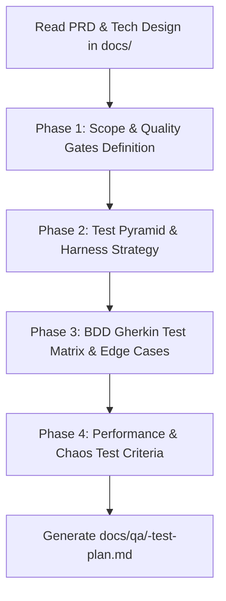

# QA & Test Strategy Planning Skill

This skill transforms product requirements and architectural designs into an actionable, rigorous **QA & Test Strategy Document**.

It ensures software is validated across the entire testing pyramid—from unit tests and contract validation to security edge cases, chaos failure tests, and performance benchmarks.

---

## Workflow Overview



---

## Execution Phases

### Phase 0: Context Ingestion (Hybrid Smart Chaining)
1. **Auto-Discovery:**
   - Scan `docs/prd/` for user stories and acceptance criteria.
   - Scan `docs/architecture/` for API contracts, database schemas, and STRIDE threat models.
2. **Fallback:** If files are missing, interview the user for:
   - Critical user flows and failure-intolerant actions.
   - Target API contracts and concurrency expectations.
   - Key non-functional metrics (expected peak RPS, latency ceilings).

---

### Phase 1: Quality Gates & Pass/Fail Criteria
Establish non-negotiable thresholds before release:
- Code coverage targets (branch coverage on domain logic).
- Zero-tolerance criteria (zero open P0/P1 defects).
- Automated regression criteria in CI pipelines.

---

### Phase 2: Testing Pyramid & Automation Breakdown
Map out test coverage across layers:
- **Unit (60%):** Pure business logic, state machines, input validation.
- **Integration & Contract (30%):** Database transactions via Testcontainers, external API mocks, OpenAPI/Pact contract testing.
- **End-to-End / Journey (10%):** Critical user workflows via Playwright/Cypress.

---

### Phase 3: Gherkin BDD Test Scenarios & Edge Cases
Generate structured Gherkin test scenarios:
- **Happy Paths:** Standard end-to-end task completion.
- **Boundary & Validation Tests:** Invalid payloads, max string lengths, malformed UUIDs.
- **Concurrency & Race Conditions:** Duplicate idempotent keys, simultaneous updates.
- **Security & Authorization:** IDOR attempts, unauthenticated calls, role bypass tests.

---

### Phase 4: Non-Functional & Resilience Testing
- **Load / Stress Profile:** Target RPS, ramp-up schedules, and latency SLOs (P50, P95, P99).
- **Chaos Verification:** Simulating database failovers, cache flushes, and third-party webhook dropouts.

---

### Phase 5: Output Generation
1. Write the completed test plan to:
   ```
   docs/qa/<feature-name>-test-plan.md
   ```
2. Reference the template at `templates/test-plan.md`.
3. Provide the user with a direct link and a list of blocking test suites required before launch.
