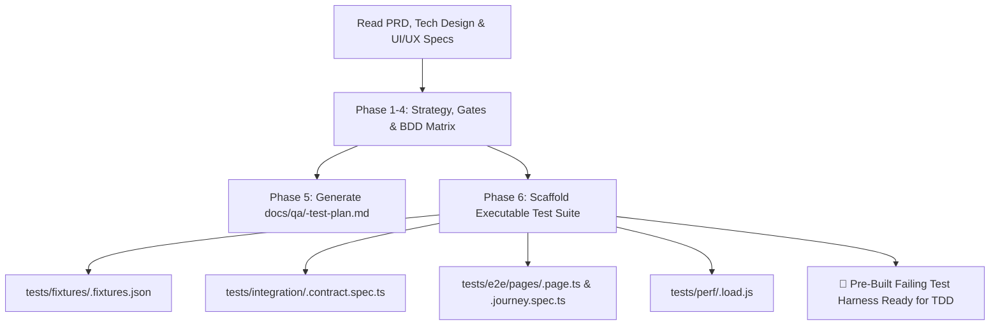

# QA Test Planner & Automation Suite Generator Skill

This skill acts as your **QA Architect & Test Automation Lead**. It transforms product requirements, architectural contracts, and UI/UX specs into both an authoritative **QA Strategy Document** and a **complete, runnable test harness** (`.spec` files, Page Object Models, test data fixtures, and k6 load scripts).

By generating the failing tests **before** coding begins ("Instant Red"), developers and the `tdd-task-executor` can execute pure Test-Driven Development against pre-built assertions.

---

## Workflow Overview



---

## Execution Phases

### Phase 0: Context Ingestion (Hybrid Smart Chaining)
1. Automatically scan the workspace for:
   - PRD: `docs/prd/<feature>-prd.md` (User stories, acceptance criteria, non-goals)
   - UI/UX Design: `docs/design/<feature>-design-spec.md` (Screens, 8 interaction states, a11y)
   - Tech Design: `docs/architecture/<feature>-tech-design.md` (API contracts, DB schemas, STRIDE)
2. Identify the tech stack in use (TypeScript/Node, Python, Go, etc.) to tailor the `.spec` syntax (Vitest, Jest, Pytest, Playwright).

---

### Phase 1: Quality Gates & Pass/Fail Criteria
Establish non-negotiable release thresholds in the strategy doc:
- Code coverage targets ($\ge 85\%$ branch coverage on domain logic).
- Zero-tolerance criteria (0 open P0/P1 defects).
- Automated CI pipeline gating gates.

---

### Phase 2: Testing Pyramid Allocation
Structure the verification strategy across layers:
- **Unit (60%):** Fast in-memory business logic and validation assertions.
- **Integration & Contract (30%):** API schema enforcement, DB transactions via Testcontainers, and idempotency guarantees.
- **End-to-End / Journey (10%):** Real browser flows via Playwright with Page Object Models.

---

### Phase 3: Gherkin BDD Test Scenarios & Edge Cases
Formulate Gherkin scenarios for:
- Happy paths.
- Malformed / boundary payload rejections.
- Concurrent requests with duplicate `Idempotency-Key` headers.
- Security boundary penetration (IDOR tenant isolation, missing JWTs).

---

### Phase 4: Non-Functional & Performance Profiling
Define performance SLOs:
- P95 latency $< 200\text{ms}$ under $2\times$ projected peak load.
- Error rate $< 0.1\%$ under sustained traffic.
- Chaos resilience criteria (DB failover, cache evictions).

---

### Phase 5: Strategy Document Output
Write the formal QA Strategy document to:
```
docs/qa/<feature-name>-test-plan.md
```
*(Referencing `templates/test-plan.md`).*

---

### Phase 6: Executable Test Suite Generation (The Code Harness)

Generate the actual runnable test files matching the project's framework:

1. **Synthetic Data Fixtures:**
   - Path: `tests/fixtures/<feature-name>.fixtures.json`
   - Contains: Valid payloads, boundary edge cases (max string length, unicode, SQL injection strings), and invalid schemas.
   - Reference: `templates/fixtures.json.template`

2. **Integration & API Contract Tests:**
   - Path: `tests/integration/<feature-name>.contract.spec.ts`
   - Contains: Supertest/Vitest/Jest tests asserting HTTP status codes (201, 400, 401, 409), headers, and schema shapes.
   - Reference: `templates/contract.spec.ts.template`

3. **Playwright E2E Page Object Model & Journey Spec:**
   - Page Object Path: `tests/e2e/pages/<feature-name>.page.ts`
   - Journey Spec Path: `tests/e2e/<feature-name>.journey.spec.ts`
   - Contains: Accessible locators (`getByRole`, `getByLabel`), form submission, interaction state verification, and WCAG tab navigation tests.
   - References: `templates/page-object.ts.template` & `templates/journey.spec.ts.template`

4. **k6 Performance & Load Benchmark Script:**
   - Path: `tests/perf/<feature-name>.load.js`
   - Contains: Executable k6 load test script configured with ramp-up stages and SLO thresholds (`p(95)<200ms`, `rate<0.001`).
   - Reference: `templates/load-test.k6.js.template`

---

## Result: "Instant Red" for TDD

Once this skill finishes, you have a complete suite of failing `.spec` files. When you hand off to `tdd-task-executor`, the Coder Personas do not need to guess how to write tests—they run the pre-built test suite, see the expected red failure, and write production code to turn them green.
