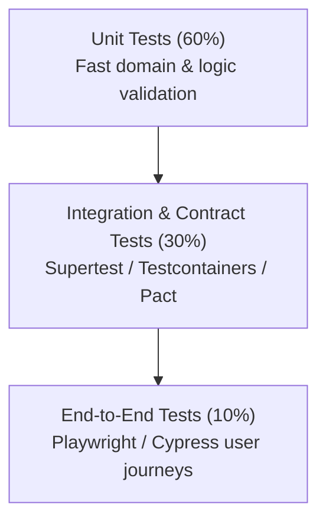

# [QA & Test Strategy] {Feature / System Name}

**PRD Reference:** [`docs/prd/{feature-name}-prd.md`](../prd/{feature-name}-prd.md)  
**Tech Design Reference:** [`docs/architecture/{feature-name}-tech-design.md`](../architecture/{feature-name}-tech-design.md)  
**Author(s):** {QA Lead / Engineer}  
**Status:** In Review | Approved  
**Document Path:** `docs/qa/{feature-name}-test-plan.md`

---

## 1. Quality Objectives & Test Scope

### 1.1 In-Scope & Out-of-Scope
* **In-Scope for Testing:**
  - Core user journey happy paths and error states.
  - API boundary contract validation and schema compliance.
  - Concurrency, race conditions, and idempotency guarantees.
  - Performance, latency, and load benchmarks under peak traffic.
* **Out-of-Scope:**
  - 3rd party vendor infrastructure failure outside mockable boundaries.
  - Deprecated legacy mobile client versions (< v2.4).

### 1.2 Quality Gates & Pass/Fail Criteria
| Gate | Metric / Criteria | Blocking? |
| :--- | :--- | :--- |
| **Unit Test Coverage** | $\ge 85\%$ branch coverage on business domain logic | Yes |
| **Integration Suite** | 100% pass on critical API contracts | Yes |
| **P0/P1 Defects** | 0 open blocker or critical bugs | Yes |
| **Performance Benchmark** | P95 latency $< 200\text{ms}$ under $2\times$ projected peak load | Yes |

---

## 2. Testing Pyramid & Automation Strategy



| Test Layer | Framework / Tools | Execution Environment | Trigger |
| :--- | :--- | :--- | :--- |
| **Unit** | Jest / Pytest / Go test | Isolated in-memory runner | Pre-commit / Every PR |
| **Integration** | Testcontainers (real DB & Redis) | Ephemeral Docker CI | Every PR merge |
| **Contract** | Pact / Spectral OpenAPI linter | CI pipeline | Service build step |
| **E2E** | Playwright / Headless Chrome | Staging / Preview environment | Nightly & Pre-release |

---

## 3. Test Scenarios & Edge Cases (Gherkin BDD Matrix)

### TC-01: Happy Path - Resource Creation & Event Broadcast
```gherkin
Feature: Resource Creation
  Scenario: Successfully create a resource with idempotent key
    Given a valid authenticated enterprise user with 'write:resource' role
    And an Idempotency-Key header '550e8400-e29b-41d4-a716-446655440000'
    When sending POST to '/api/v1/resources' with valid payload
    Then the response status should be 201 Created
    And the response body should contain the generated resource ID
    And a background event should be published to Kafka topic 'resources.created'
```

### TC-02: Edge Case - Concurrent Submissions with Same Idempotency Key
```gherkin
  Scenario: Duplicate request sent concurrently
    Given a request with Idempotency-Key 'KEY-123' is actively being processed
    When a duplicate POST request arrives with identical Idempotency-Key
    Then the second request should not trigger a second database insert
    And it should either wait for the original response or return 409 Conflict with retry header
```

### TC-03: Security & Negative Boundary Test
```gherkin
  Scenario: Tenant cross-access attempt (IDOR prevention)
    Given User A belongs to Tenant X
    When User A attempts to GET '/api/v1/resources/{id}' belonging to Tenant Y
    Then the response status must be 404 Not Found (or 403 Forbidden without leaking existence)
```

---

## 4. Non-Functional & Performance Testing Plan

### 4.1 Load & Stress Test Profile
* **Tool:** k6 / Locust
* **Target Load:** 1,500 RPS sustained for 30 minutes; ramp-up spike to 3,000 RPS for 5 minutes.
* **Service Level Objectives (SLOs):**
  - **P50 Latency:** $< 50\text{ms}$
  - **P95 Latency:** $< 180\text{ms}$
  - **P99 Latency:** $< 450\text{ms}$
  - **Error Rate (5xx):** $< 0.01\%$

### 4.2 Chaos & Resilience Verification
- **Database Partition:** Simulate primary DB failover to replica; verify reconnection without process restart.
- **Cache Eviction:** Verify system remains stable if Redis cache is flushed during moderate traffic.
- **Downstream Timeout:** Verify circuit breaker trips when 3rd party webhook latency exceeds 2.5s.

---

## 5. Test Data Management & Environment Matrix

- **Staging Data Sanitization:** Synthetic test data generated via seed scripts; no production PII imported.
- **Fixtures & Cleaners:** Database transactions rolled back or ephemeral Docker containers destroyed between test suites.
- **Test Matrix Table:**
  | Dimension | Platforms / Configurations Tested |
  | :--- | :--- |
  | **Browsers** | Chrome latest, Safari latest, Firefox latest |
  | **Mobile Clients** | iOS 17+, Android 14+ |
  | **Database Engines** | PostgreSQL 15 & 16 |
