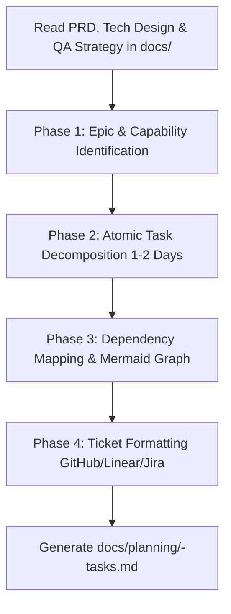

# Spec to Backlog & Sprint Execution Planner Skill

This skill turns high-level engineering specifications (PRDs, Technical Design Docs, and QA Strategies) into an immediately executable **Sprint Backlog & Task Breakdown**.

It bridges the gap between document approval and day-to-day coding by sequencing dependencies, estimating task effort, defining task-level Definitions of Done, and producing tickets formatted for GitHub Issues, Linear, and Jira.

---

## Workflow Overview



---

## Execution Phases

### Phase 0: Context Ingestion (Hybrid Smart Chaining)
1. Automatically scan the workspace for:
   - PRD: `docs/prd/<feature>-prd.md`
   - Technical Design: `docs/architecture/<feature>-tech-design.md`
   - QA Strategy: `docs/qa/<feature>-test-plan.md`
2. Extract the implementation scope:
   - User stories and acceptance criteria.
   - Database tables, migrations, and caching layers.
   - API endpoints, controllers, and middlewares.
   - Non-functional benchmarks and testing suites.

---

### Phase 1: Epic & Capability Structuring
Organize the work into logical milestone epics:
- **Epic 1: Data & Infrastructure Foundation:** Migrations, ORM models, message queues, caches.
- **Epic 2: Core Domain Logic & Business Rules:** Service layers, state machines, internal handlers.
- **Epic 3: APIs, Interfaces & Security:** HTTP route controllers, auth middleware, request validation.
- **Epic 4: Integration, Testing & Conformance Verification:** Automated test suites, drift audit checks.

---

### Phase 2: Atomic Task Decomposition (Sized to $\le 1-2$ Days)
Decompose each epic into atomic tasks:
- **Effort Sizing:** Each task should ideally take **1 to 2 developer days** (maximum 3 days). If a task exceeds 3 days, split it.
- **Clear Boundaries:** Explicitly identify target files and modules to modify or create.
- **Actionable Steps:** Step-by-step guidance on what code to write.
- **Definition of Done (DoD):** Concrete checklist covering code quality, tests written, and documentation updated.

---

### Phase 3: Dependency Mapping & Critical Path
- Identify **"Blocked By"** and **"Blocks"** relationships for each task.
- Generate a visual Mermaid dependency graph (`flowchart TD` or `flowchart LR`) showing what can be parallelized versus what must be built sequentially.
- Flag any critical path bottlenecks (e.g. database schema blocking both frontend and backend).

---

### Phase 4: Output Generation & Platform Export
1. Write the completed execution plan to:
   ```
   docs/planning/<feature-name>-tasks.md
   ```
2. Reference the template at `templates/backlog-plan.md`.
3. Provide ready-to-copy Markdown blocks formatted for:
   - **GitHub Issues** (with checkboxes and labels).
   - **Linear** (with estimates and dependencies).
   - **Jira** (with acceptance criteria and epic linking).
