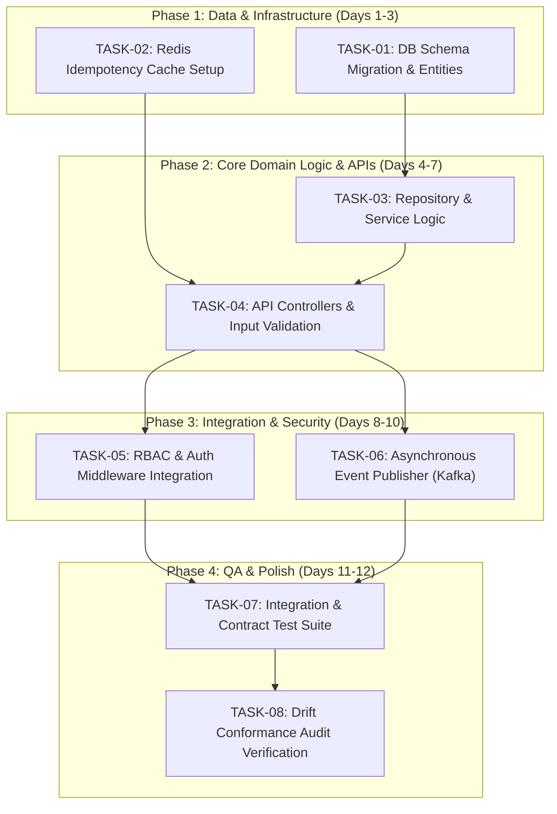

# [Sprint Execution Plan & Backlog] {Feature / Epic Name}

**PRD Reference:** [`docs/prd/{feature-name}-prd.md`](../prd/{feature-name}-prd.md)  
**Tech Design Reference:** [`docs/architecture/{feature-name}-tech-design.md`](../architecture/{feature-name}-tech-design.md)  
**QA Strategy Reference:** [`docs/qa/{feature-name}-test-plan.md`](../qa/{feature-name}-test-plan.md)  
**Target Milestone:** Sprint {X} - {YYYY-MM-DD} to {YYYY-MM-DD}  
**Document Path:** `docs/planning/{feature-name}-tasks.md`

---

## 1. Execution Overview & Dependency Graph

### 1.1 Critical Path & Sequence (Mermaid)


---

## 2. Epics & Sized Task Breakdown

### Epic 1: {Epic Title, e.g. Data Layer & Core Domain Services}

#### TASK-01: {Task Title, e.g. Implement Database Migration & ORM Models}
* **Estimated Effort:** 1 day (1-2 pts)
* **Assigned Role:** Backend / Data Engineer
* **Blocked By:** None
* **Blocks:** TASK-03, TASK-04
* **Affected Files / Modules:**
  - `migrations/20261107_create_resources.sql`
  - `src/models/resource.entity.ts`
* **Implementation Steps:**
  1. Write SQL migration creating table with foreign keys and compound indexes.
  2. Implement ORM entity with type-safe fields and relations.
  3. Verify local migration up and rollback scripts.
* **Definition of Done (DoD):**
  - [ ] Migration runs cleanly up and down in local Docker DB.
  - [ ] Entity unit tests verify constraint validations.
  - [ ] PR passes lint and TypeScript check.

---

#### TASK-02: {Task Title, e.g. Idempotency Key Middleware & Redis Cache}
* **Estimated Effort:** 1.5 days (2-3 pts)
* **Assigned Role:** Backend Engineer
* **Blocked By:** None
* **Blocks:** TASK-04
* **Affected Files / Modules:**
  - `src/middleware/idempotency.middleware.ts`
  - `src/lib/redis.client.ts`
* **Implementation Steps:**
  1. Create Redis wrapper for atomic `SET NX EX` on `Idempotency-Key`.
  2. Implement Express/Fastify/NestJS interceptor to short-circuit cached responses.
  3. Add 409 Conflict handling for in-flight requests.
* **Definition of Done (DoD):**
  - [ ] Unit tests for cached hit, cache miss, and expired TTL states.
  - [ ] Concurrency test verifying atomic lock handling.

---

### Epic 2: {Epic Title, e.g. API Endpoints & Auth Integration}

#### TASK-03: {Task Title, e.g. Resource Controller & OpenAPI Validation}
* **Estimated Effort:** 2 days (3-5 pts)
* **Assigned Role:** Backend / Full-Stack Engineer
* **Blocked By:** TASK-01, TASK-02
* **Blocks:** TASK-05, TASK-07
* **Affected Files / Modules:**
  - `src/controllers/resource.controller.ts`
  - `src/schemas/resource.schema.ts`
* **Implementation Steps:**
  1. Define Zod / Joi validation schema matching OpenAPI contract.
  2. Implement `POST /api/v1/resources` and `GET /api/v1/resources/:id` handlers.
  3. Wire controller to underlying domain service.
* **Definition of Done (DoD):**
  - [ ] Controller conforms 100% to OpenAPI spec in `docs/architecture/`.
  - [ ] 400 Bad Request returned with formatted error array on invalid inputs.

---

## 3. Platform Ready-to-Copy Ticket Blocks

### GitHub Issues / Linear Export Format
```markdown
### [TASK-01] Implement Database Migration & ORM Models
- **Epic:** Data Layer & Core Domain Services
- **Estimate:** 1 Day
- **Dependencies:** None
- **Files:** `migrations/`, `src/models/`

**Description:**
Create the migration and entity definitions for the new resource structure based on docs/architecture/tech-design.md.

**Acceptance Criteria:**
- [ ] Table schema matches ERD in Tech Design
- [ ] Migration up/down scripts tested locally
- [ ] Entity model unit tests pass with >90% coverage
```

```markdown
### [TASK-02] Idempotency Key Middleware & Redis Cache
- **Epic:** Data Layer & Core Domain Services
- **Estimate:** 1.5 Days
- **Dependencies:** None
- **Files:** `src/middleware/idempotency.middleware.ts`

**Description:**
Implement Redis atomic lock and response caching for mutating endpoints requiring an `Idempotency-Key` header.

**Acceptance Criteria:**
- [ ] Cached responses return HTTP 200 within 20ms
- [ ] Duplicate in-flight requests return HTTP 409
- [ ] Redis keys expire cleanly using TTL
```
