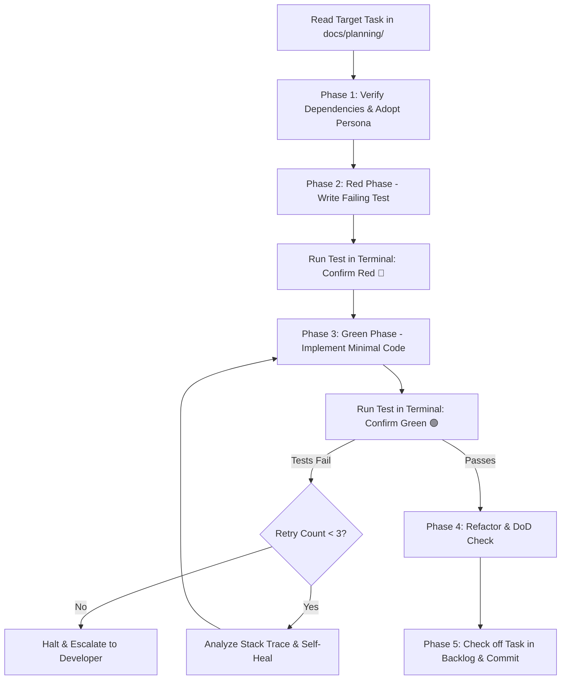

# TDD Task Executor with Coder Personas

This skill executes individual engineering tasks from your sprint backlog (`docs/planning/<feature>-tasks.md`) with disciplined **Test-Driven Development (TDD)**.

Instead of writing code blindly, it dynamically adopts specialized **Coder Personas** (Backend, Database, Frontend, Security, DevOps), writes failing tests first (Red), implements minimal code to pass (Green), self-heals terminal errors, verifies the task's Definition of Done (DoD), marks the task complete, and creates an atomic Git commit.

---

## Workflow Overview



---

## Execution Phases

### Phase 1: Task Ingestion & Persona Activation
1. Read the target task (e.g. `TASK-01`) from `docs/planning/<feature>-tasks.md`.
2. **Verify Dependencies:** Check the "Blocked By" field. If prerequisite tasks are unchecked `[ ]`, warn the user and halt unless explicitly overridden.
3. **Adopt Specialist Persona:** Inspect the task description and automatically switch into the appropriate mindset defined in [`references/personas.md`](references/personas.md):
   - **Backend API Engineer:** Controllers, services, routes, middleware, validation.
   - **Database & Migration Specialist:** SQL DDL, migrations, ERD models, foreign keys, indexes.
   - **Frontend UI Engineer:** UI components, client state, styling, accessibility (a11y).
   - **Security & Auth Specialist:** JWT tokens, RBAC permissions, encryption, rate limits.
   - **DevOps & Integration Specialist:** Docker, CI/CD, message queues, external webhooks.

---

### Phase 2: The Red Phase (Write Failing Tests)
1. Read the acceptance criteria from `docs/planning/` and the contract from `docs/architecture/` or `docs/qa/`.
2. Create or edit test files in the project's standard test directory (e.g. `tests/`, `__tests__/`, `*.spec.ts`, `*_test.go`).
3. Formulate assertions that directly verify the acceptance criteria.
4. **Execute Test:** Run the project's test command via terminal (`npm test`, `pytest`, `go test`, `cargo test`).
5. **Verify Red:** Confirm that the test suite fails **strictly due to missing functionality** (not due to syntax errors or missing test frameworks).

---

### Phase 3: The Green Phase & Autonomous Self-Healing
1. Implement the **minimal production code** required to satisfy the failing test assertions in the target files.
2. Follow the architectural constraints in `docs/architecture/tech-design.md` (e.g. don't bypass service layers or leak database queries).
3. **Execute Test:** Run the test suite again.
4. **Self-Healing Loop (Max 3 Iterations):**
   - If tests fail, inspect the stack trace and error message.
   - Diagnose root cause (type mismatch, missing parameter, unhandled promise, off-by-one).
   - Apply targeted fix and re-run.
   - If still failing after 3 attempts, halt, summarize the barrier, and ask the user for guidance.

---

### Phase 4: Refactor & Definition of Done Verification
1. **Refactor:** Clean up code, remove temporary debug logs, check for duplication, and verify type safety and linting.
2. **DoD Checklist:** Inspect each checkbox in the task's **Definition of Done (DoD)**:
   - [x] Implementation matches OpenAPI / Schema specs.
   - [x] Unit/integration tests pass with full assertions.
   - [x] No regressions introduced to existing test suites.

---

### Phase 5: Backlog Synchronization & Atomic Git Commit
1. **Sync Backlog:** Edit `docs/planning/<feature>-tasks.md` to mark the task as completed (`- [x] TASK-XX`).
2. **Conventional Commit:** Stage the modified files and generate a standard Conventional Commit message:
   ```bash
   git add <modified-files> docs/planning/<feature>-tasks.md
   git commit -m "feat(<scope>): <short task title> [TASK-XX]"
   ```
3. Report the completion summary and present the next sequential task on the critical path.
