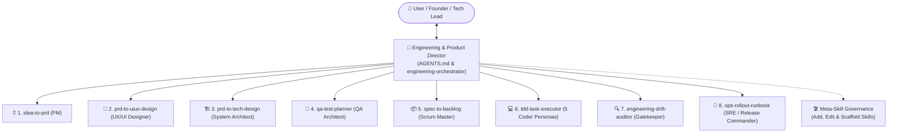
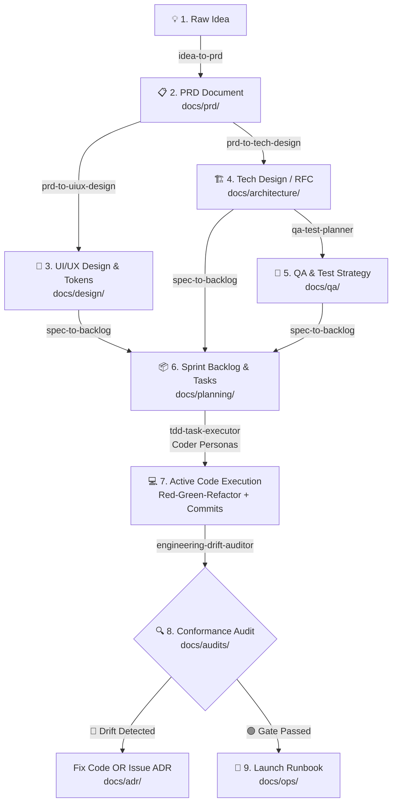

# Engineering & Product AI Skills Suite

A production-grade collection of Antigravity AI skills designed to guide cross-functional teams through the entire software development lifecycle—from raw abstract ideas and UI/UX design systems to audited, production-ready deployments.

---

## Central Leadership: The Engineering Orchestrator

This entire suite is managed by a single point of contact: the **Engineering & Product Director** (`AGENTS.md` and [`skills/engineering-orchestrator/`](skills/engineering-orchestrator/)).

You do not need to memorize individual skills. You can simply ask the Orchestrator *"Where are we?"*, *"What's next?"*, or give it a raw idea, and it will automatically inspect project health, generate **Executive Pipeline Dashboards**, route work to the appropriate specialist skill, and govern the addition or modification of skills.



---

## The 8-Stage Product & Engineering Pipeline



---

## Skills Catalog & Role Directory

| # | Skill | Role Represented | Primary Output | Location |
| :-: | :--- | :--- | :--- | :--- |
| **0** | **`engineering-orchestrator`** | Engineering & Product Director | Project Dashboard, Routing & Meta-Skills | [`skills/engineering-orchestrator/`](skills/engineering-orchestrator/) |
| **1** | **`idea-to-prd`** | Product Manager (PM) | `docs/prd/<feature>-prd.md` | [`skills/idea-to-prd/`](skills/idea-to-prd/) |
| **2** | **`prd-to-uiux-design`** | Product Designer (UI/UX) | `docs/design/<feature>-design-spec.md` | [`skills/prd-to-uiux-design/`](skills/prd-to-uiux-design/) |
| **3** | **`prd-to-tech-design`** | System Architect / Tech Lead | `docs/architecture/<feature>-tech-design.md` | [`skills/prd-to-tech-design/`](skills/prd-to-tech-design/) |
| **4** | **`qa-test-planner`** | QA Architect / Test Automation Lead | `docs/qa/<feature>-test-plan.md` & `tests/*.spec.ts` | [`skills/qa-test-planner/`](skills/qa-test-planner/) |
| **5** | **`spec-to-backlog`** | Scrum Master / Delivery Lead | `docs/planning/<feature>-tasks.md` | [`skills/spec-to-backlog/`](skills/spec-to-backlog/) |
| **6** | **`tdd-task-executor`** | 5 Full-Stack Coder Personas | Source code, test suites, git commits | [`skills/tdd-task-executor/`](skills/tdd-task-executor/) |
| **7** | **`engineering-drift-auditor`** | Conformance Gatekeeper | `docs/audits/<feature>-conformance-audit.md` | [`skills/engineering-drift-auditor/`](skills/engineering-drift-auditor/) |
| **8** | **`ops-rollout-runbook`** | SRE / Release Commander | `docs/ops/<feature>-runbook.md` | [`skills/ops-rollout-runbook/`](skills/ops-rollout-runbook/) |

---

## Installation & Deployment ("Downloading the Team")

Whenever you change computers, reinstall Antigravity, or want to bring this team to another project, run:

### Method 1: Global Installation (Recommended)
Installs the entire suite to `~/.gemini/config/skills` and sets `AGENTS.md` as your global directive, making the team available in **all** workspaces:
```bash
git clone https://github.com/varienjanitra/ai-skills.git ~/ai-skills
cd ~/ai-skills
./scripts/install.sh product-engineering --global
```

### Method 2: Project-Specific Installation
Deploys the team directly into an individual repository's `.agents/skills/`:
```bash
./scripts/install.sh product-engineering /path/to/my-target-project
```

---

## Backing Up & Exporting Modified Skills

When you or the Director add new skills or modify existing ones, ask the Director:
> *"Director, export our modified skills for backup."*

The Director will automatically:
1. Reconcile and sync `skills/` with `.agents/skills/`.
2. Verify all frontmatter and templates.
3. Stage and generate a structured Conventional Git Commit so you can simply run `git push origin main`.

---

## How to Interact with Your Engineering Director

Because [`AGENTS.md`](AGENTS.md) is always active, you can talk naturally in chat:

- **Check Project Status:** *"Where are we with the project?"* or *"Give me a status dashboard."*
- **Start a New Initiative:** *"I have an idea for [describe idea]. Where do we start?"*
- **Advance the Pipeline:** *"PRD is approved. Let's move to the next phase."*
- **Execute Code:** *"Let's implement TASK-01 from our sprint backlog."*
- **Run Quality Audit:** *"Audit our code to make sure we haven't drifted from our specs."*
- **Evolve the Skills:** *"I want to add a new skill for Customer Support playbooks."* *(The Director will conduct an alignment interview and scaffold it).*
